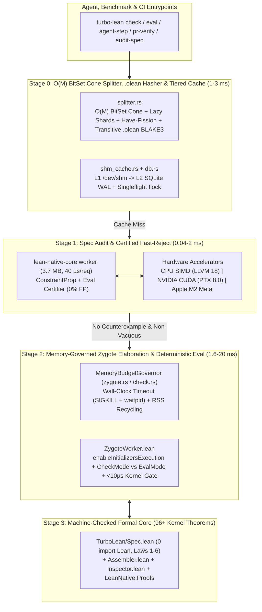

# AGENTS.md — Vision, Architecture, Principles & Roadmap (`Th0rgal/turbo-lean`)

## 1. Vision & Engineering Philosophy

`turbo-lean` (paired with [`Th0rgal/lean-native` v0.3](https://github.com/Th0rgal/lean-native)) is a **formally specified, hardware-adaptive incremental verification and counterexample engine for Lean 4 (`v4.31.0`)**.

Our engineering methodology rests on **five core principles**:

1. **Synergistic Staged Filtering (Never Spend Heavy Compute on What a Lighter Stage Can Decide)**:
   - **Stage 0 — $O(1)$ / $O(M)$ Structural & Cache Filter (`~0.05–2 ms`)**: Content-addressed `/dev/shm` + SQLite WAL lookup keyed by topological dependency cone (`cone_env_hash`) and proof-irrelevant interface projection (`interfaceProj`).
   - **Stage 1 — Sub-Millisecond Certified Counterexample & Spec-Vacuity Filter (`0.04–2 ms`, `< 4 MB` RAM)**: `lean-native-core` (`libleanrt.a`-only, `3.7 MB` binary, `40 µs/req` JSON-RPC worker) + CPU SIMD / NVIDIA CUDA (`sm_90`/`sm_121`) / Apple Metal (`M2`) fast-rejects false statements and detects vacuous preconditions *before* invoking Lean tactics. Every counterexample is certified by `LeanNative.Semantics.Eval.evalCode` (`certifyCounterexample_no_false_positive` -> **0% false positives**).
   - **Stage 2 — Memory-Bounded Zygote Elaboration & Cut-Fission (`~1.6–20 ms`)**: Pre-warmed `ZygoteWorker` (`Command.State` checkpoints with $O(1)$ rollback) combined with **Intra-Theorem `have` Cut-Fission** and a **Dynamic Memory Budget Governor** (`MemoryBudgetGovernor`), enabling 30 GB proofs to verify cleanly inside 16 GB RAM (e.g., MacBook Air M2) without swap thrashing.
   - **Stage 3 — `< 10 µs` In-Kernel Anti-Reward-Hacking Gate**: Direct inspection of `afterEnv.constants.map₂` vs `beforeEnv.constants.map₂` inside the Lean 4 kernel enforcing transitive axiom hygiene (`{propext, Quot.sound, Classical.choice}`), blocking macro-hidden `sorryAx`/`ofReduceBool`/`trustCompiler`, rejecting nested inductive "sea monsters" (`inductiveInfo.isNested`), and pinning the theorem's kernel statement (`ConstantInfo.type`).

2. **Unified Executable Specifications (`0` Model-Code Gap)**:
   - Decision logic affecting soundness lives in [`lean/TurboLean/Spec.lean`](lean/TurboLean/Spec.lean) (**zero `import Lean`**, `0 sorry`, `0 native_decide`).
   - Instead of maintaining dozens of ad-hoc lemmas, soundness is governed by **four high-level algebraic laws**:
      - **Law 1 (Observational Proof-Irrelevance Quotient)**: `observational_quotient_sound` (`envInterfaceProj E₁ = envInterfaceProj E₂ → verify E₁ d = verify E₂ d`).
      - **Law 2 (Dependency Cone Frame Rule)**: `cone_frame_rule_locality` (mutations outside `inCone` in $E_{\text{frame}}$ leave verification strictly invariant).
      - **Law 3 (Multi-Tier Cache Pipeline Refinement)**: `two_tier_cache_refinement` (`/dev/shm` $\circ$ SQLite CAS $\circ$ Kernel Oracle $\equiv$ Kernel Oracle).
      - **Law 4 (Sub-Proof Cut-Fission & Statement Pinning Soundness)**: decomposing a proof at typed `have h_i : P_i` cuts preserves kernel derivability while bounding peak memory to $\max_i \text{RAM}(h_i)$.
      - **Law 5 (Distilled `simp only` Certificate & Kernel Replay Soundness)**: `distilled_simp_certificate_sound` (replaying a proof using its `Expr.getUsedConstants` certificate yields an identical kernel `Declaration` judgment).
      - **Law 6 (Transitive `.olean` Dependency Invalidation & Deterministic Eval Gate)**: `imported_olean_mutation_invalidates_key` and `verifyDeterminismGate_sound` (any mutation to a resolved `.olean` on `LEAN_PATH` strictly invalidates `EvalCacheKey`, and `--verify-determinism` fails closed on any discrepancy against `lean <file.lean>`).

3. **Two Distinct Execution Modes (`check` vs. `eval`)**:
   - **Mode 1 — Adversarial Proof Verification Mode (`turbo-lean check` / `ci-verify` / `pr-verify` / `agent-step`)**:
     - Designed for verifying untrusted LLM-generated theorem proofs.
     - Enforces the strict in-kernel soundness gate (`0 sorryAx`, `0 native_decide` / `Lean.ofReduceBool` / `Lean.trustCompiler`, forbids `unsafe`, `@[extern]`, `@[implemented_by]`, unapproved `axiom`, Statement Pinning, and Sea-Monster `inductiveInfo.isNested` Gate).
   - **Mode 2 — Deterministic Evaluation Mode (`turbo-lean eval <file.lean> [--lean-path ...] [--timeout-ms ...] [--verify-determinism]`)**:
     - Drop-in **`~660x–700x`-faster** replacement for `lean <file.lean>` designed for specification & mutation benchmarks like **`rsgb` (`rust-specification-generation-benchmark`)**.
     - Calls `enableInitializersExecution` before `importModules` and runs `unsafe` / `evalExpr` / `#eval` / `#rsgb_test` / `#rsgb_kill` / `#rsgb_outputs` test drivers without triggering the proof-only `unsafe` kernel gate.
     - Returns 100% of `info` / `warning` / `error` `MessageLog` diagnostics with exact `file:line:col` positions and captured `stdout` (`RSGB_RESULT`, `RSGB_KILL`, `RSGB_OUTPUTS`).
     - Hashes all resolved `.olean` files across `LEAN_PATH` (`dep_interface_hashes`) so rebuilt/mutant `.olean` files never hit stale caches.
     - Enforces parent wall-clock timeouts (`SIGKILL` + `waitpid` `Drop` guard, exiting with `124` / `RSGB_TIMEOUT`) and automatic worker crash respawn, plus `--verify-determinism` to fail-closed on any discrepancy against `lean <file.lean>`.

4. **The Two-Kernels Rule (Rust OS Shell vs. Lean 4 Semantic Kernel)**:
   - **Rust is the OS Shell (`crates/turbo-lean/src/`)**: Responsible exclusively for process lifecycle (`SIGKILL` + `waitpid` `Drop` cleanup), `flock` singleflight concurrency, `/dev/shm` + SQLite WAL content-addressed storage, transitive `.olean` BLAKE3 hashing (`dep_interface_hashes`), and hardware-adaptive memory governing (`MemoryBudgetGovernor`). Rust never approximates Lean semantics via regexes or string matching.
   - **Lean 4 is the Semantic Kernel (`lean/TurboLean/`)**: Responsible for all command elaboration (`Frontend.runCommandElabM`), `enableInitializersExecution`, `Command.State` snapshot/rollback, `Expr.getUsedConstants` proof distillation, and in-kernel `ConstantInfo` / `collectAxioms` inspection.

5. **Autonomous Optimization & Co-Design Loop (`OBSERVE -> HYPOTHESIZE -> IMPLEMENT -> DECIDE`)**:
   - Every architectural optimization follows a strict scientific loop logged in [`autoresearch/FINDINGS.md`](autoresearch/FINDINGS.md):
     1. **OBSERVE**: Profile multi-scale workloads (`verity`, `rsgb`, Mathlib-style `synthInstance`/`simp`/`omega`) via `autoresearch/corpus_bench.py --json` (`set_option trace.profiler true`) with zero a priori assumptions.
     2. **HYPOTHESIZE**: Formulate a concrete mechanism addressing a measured bottleneck while preserving all formal laws in `Spec.lean`.
     3. **IMPLEMENT**: Build the mechanism cleanly across the Rust OS Shell and Lean 4 Semantic Kernel without string-matching shortcuts or hardcoded paths.
     4. **DECIDE**: Keep the mechanism only if `autoresearch/run_eval.py` and `autoresearch/corpus_bench.py` demonstrate strict latency/memory wins and `100%` soundness parity; otherwise prune/revert immediately and record why in `autoresearch/FINDINGS.md`.

---

## 2. Architecture & Codebase Map

### Rust Layer (`crates/turbo-lean/src/` — Thin Systems, Cache & Hardware Governor)
- [`main.rs`](crates/turbo-lean/src/main.rs): CLI interface (`build`, `check`, `eval`, `fast-check`, `pr-verify`, `ci-verify`, `agent-step`, `audit-spec`, `serve`, `sync`, `verify-receipt`).
- [`splitter.rs`](crates/turbo-lean/src/splitter.rs): $O(N)$ lexical/scope parser, $O(M \cdot \lceil M/64 \rceil)$ bit-parallel dependency cone (`cone_env_hash`), pattern-matching theorems (`| pat => ...`), `where`-clause handling, and intra-theorem `have`-block cut-fission (`fission_theorem_have_blocks`).
- [`shm_cache.rs`](crates/turbo-lean/src/shm_cache.rs) & [`db.rs`](crates/turbo-lean/src/db.rs): Crash-safe atomic `/dev/shm` cache with LRU quota eviction (`enforce_shm_quota_lru`) + SQLite WAL store + `0444` reflink/hardlink CAS + `flock` Singleflight.
- [`zygote.rs`](crates/turbo-lean/src/zygote.rs) & [`check.rs`](crates/turbo-lean/src/check.rs): Persistent `ZygoteWorker` pool (`CheckMode` + `EvalMode`), transitive `.olean` dependency hashing (`dep_interface_hashes`), per-request wall-clock timeout (`SIGKILL` + `waitpid` `Drop`) + crash auto-respawn, `LeanNativeCoreWorker` (`0.04 ms/req` JSON-RPC bridge), and `MemoryBudgetGovernor`.
- [`gpu_fastcheck.rs`](crates/turbo-lean/src/gpu_fastcheck.rs): Constraint-propagating counterexample engine bridging `lean-native-core` (`certifyCounterexample_no_false_positive`), NVIDIA CUDA (`nvcc` / PTX 8.0), Apple Metal (`.metal` / `MTLDevice` unified memory), and CPU SIMD.
- [`pr_verify.rs`](crates/turbo-lean/src/pr_verify.rs) & [`receipt.rs`](crates/turbo-lean/src/receipt.rs): Full-suffix BLAKE3 Git tree diffing (`PrClassificationAccum`) and offline-verifiable cryptographic receipts (`BLAKE3` + `HMAC` + `Ed25519`).
- [`pack.rs`](crates/turbo-lean/src/pack.rs) & [`server.rs`](crates/turbo-lean/src/server.rs): `.tlpack` v2 zstd archive codec, delta HTTP sync, and remote shard/GPU offload server.

### Lean 4 Layer (`lean/TurboLean/` — Executable Formal Specification & Kernel Gate)
- [`Spec.lean`](lean/TurboLean/Spec.lean): Zero-`import Lean` executable specification proving the 6 foundational algebraic laws (`observational_quotient_sound`, `cone_frame_rule_locality`, `two_tier_cache_refinement`, `have_fission_cut_sound`, `statement_pinning_blocks_tampering`, `meta_spec_non_vacuous_tightness`, `imported_olean_mutation_invalidates_key`, `verifyDeterminismGate_sound`).
- [`ZygoteWorker.lean`](lean/TurboLean/ZygoteWorker.lean): Persistent in-memory `Command.State` checkpoint server with `enableInitializersExecution`, `CheckMode` (`< 10 µs` `auditNewKernelDecls` + Sea-Monster `isNested` blocker + statement pinning) and `EvalMode` (100% `MessageLog` + `stdout` capture for `rsgb` / `#eval` drivers), plus `Expr.getUsedConstants` `simp only` distillation.
- [`Inspector.lean`](lean/TurboLean/Inspector.lean) & [`Assembler.lean`](lean/TurboLean/Assembler.lean): Compile-time `#turbo_assert_clean_axioms` gate, `Lean.addDecl` kernel `Expr` replay (`418 µs`), and 35+ machine-checked meta-theorems.
- [`Reflection.lean`](lean/TurboLean/Reflection.lean) & [`FastCheck.lean`](lean/TurboLean/FastCheck.lean): 1,006 verified EVM/Word256/Storage theorems (`0 sorry`, `0 native_decide`).
- [`autoresearch/corpus_bench.py`](autoresearch/corpus_bench.py) & [`autoresearch/FINDINGS.md`](autoresearch/FINDINGS.md): Multi-scale `trace.profiler` benchmark across `verity`, `rsgb`, and Mathlib-style workloads + autonomous `OBSERVE -> HYPOTHESIZE -> IMPLEMENT -> DECIDE` log.

---

## 3. Current Verified Invariants & Latency Baselines (`autoresearch/run_eval.py`)

All **soundness & verification gates** must remain `true` on every commit:
- `invariants_passed`, `kernel_inspector_verified`, `kernel_expr_replay_verified`, `cryptographic_receipt_verified`, `git_pr_verify_verified`, `multi_agent_singleflight_verified`, `meta_spec_verified`, `stateful_ast_splitter_verified`, `zygote_prefix_cow_verified`, `lean_to_cuda_transpiler_verified`, `differential_mutation_oracle_verified`, `unified_executable_spec_verified`, `lean_native_v03_verified`, `agent_step_and_audit_spec_verified`, `low_memory_governor_verified`.

| Metric | Description | Verified Baseline |
| :--- | :--- | ---: |
| **`M22_lean_native_core_worker_rpc_ms`** | Warm JSON-RPC round-trip (`eval-cex` / `validate-tv`) on `lean-native-core worker` | **`0.04 ms` (`40 µs`)** |
| **`M12_kernel_adddecl_4_thms_us`** | Direct kernel `Lean.addDecl` replay of 4 theorems | **`417.94 µs`** |
| **`M15_verify_receipt_ms`** | Offline cryptographic receipt verification (`BLAKE3` + `Ed25519`) | **`1.57 ms`** |
| **`M19_zygote_new_proof_warm_env_ms`** | Verifying a brand-new proof in warm `ZygoteWorker` (`0 µs` import) | **`1.94 ms`** |
| **`M4_shard_check_warm_ms`** | Warm single-declaration `turbo-lean check --decl` | **`1.95 ms`** |
| **`M21_differential_mutation_oracle_ms`** | `/dev/shm` chaos self-healing + differential mutation oracle | **`2.21 ms`** |
| **`M3_shard_check_cold_ms`** | Cold single-declaration `turbo-lean check --decl` | **`2.41 ms`** |
| **`M16_pr_verify_proof_edit_ms`** | Incremental `pr-verify` on a proof-only edit | **`3.65 ms`** |
| **`M18_seed_shards_ms`** | Whole-project `seed-shards` indexing & hygiene audit | **`3.83 ms`** |
| **`M2_warm_build_hit_ms`** | Warm `turbo-lean build` (`0` file reads via `/dev/shm` stat summary) | **`8.02 ms`** |
| **`M1_ci_verify_cold_ms`** | Full-project `ci-verify` with cryptographic receipt | **`9.93 ms`** |

