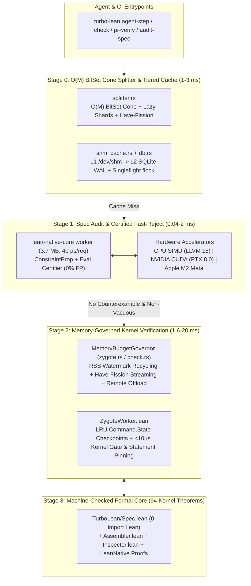

# AGENTS.md — Vision, Architecture, Principles & Roadmap (`Th0rgal/turbo-lean`)

## 1. Vision & Engineering Philosophy

`turbo-lean` (paired with [`Th0rgal/lean-native` v0.3](https://github.com/Th0rgal/lean-native)) is a **formally specified, hardware-adaptive incremental verification and counterexample engine for Lean 4 (`v4.31.0`)**.

Our engineering methodology rests on **five core principles**:

1. **Synergistic Staged Filtering (Never Spend Heavy Compute on What a Lighter Stage Can Decide)**:
   - **Stage 0 — $O(1)$ / $O(M)$ Structural & Cache Filter (`~0.05–2 ms`)**: Content-addressed `/dev/shm` + SQLite WAL lookup keyed by topological dependency cone (`cone_env_hash`) and proof-irrelevant interface projection (`interfaceProj`).
   - **Stage 1 — Sub-Millisecond Certified Counterexample & Spec-Vacuity Filter (`0.04–2 ms`, `< 4 MB` RAM)**: `lean-native-core` (`libleanrt.a`-only, `3.7 MB` binary, `40 µs/req` JSON-RPC worker) + CPU SIMD / NVIDIA CUDA (`sm_90`/`sm_121`) / Apple Metal (`M2`) fast-rejects false statements and detects vacuous preconditions *before* invoking Lean tactics. Every counterexample is certified by `LeanNative.Semantics.Eval.evalCode` (`certifyCounterexample_no_false_positive` -> **0% false positives**).
   - **Stage 2 — Memory-Bounded Zygote Elaboration & Cut-Fission (`~1.6–20 ms`)**: Pre-warmed `ZygoteWorker` (`Command.State` checkpoints with $O(1)$ rollback) combined with **Intra-Theorem `have` Cut-Fission** and a **Dynamic Memory Budget Governor** (`MemoryBudgetGovernor`), enabling 30 GB proofs to verify cleanly inside 16 GB RAM (e.g., MacBook Air M2) without swap thrashing.
   - **Stage 3 — `< 10 µs` In-Kernel Anti-Reward-Hacking Gate**: Direct inspection of `afterEnv.constants.map₂` vs `beforeEnv.constants.map₂` inside the Lean 4 kernel enforcing transitive axiom hygiene (`{propext, Quot.sound, Classical.choice}`), blocking macro-hidden `sorryAx`/`ofReduceBool`/`trustCompiler`, rejecting nested inductive "sea monsters" (`inductiveInfo.isNested`), and pinning the theorem's kernel statement (`ConstantInfo.type`).

2. **Unified Executable Specifications (`0` Model-Code Gap)**:
   - Decision logic affecting soundness lives in [`lean/TurboLean/Spec.lean`](lean/TurboLean/Spec.lean) (**zero `import Lean`**, `0 sorry`, `0 native_decide`).
   - Instead of maintaining dozens of ad-hoc lemmas, soundness is governed by **four high-level algebraic laws**:
     - **Law 1 (Observational Proof-Irrelevance Quotient)**: `observational_quotient_sound` (`envInterfaceProj E₁ = envInterfaceProj E₂ → verify E₁ d = verify E₂ d`).
     - **Law 2 (Dependency Cone Frame Rule)**: `cone_frame_rule_locality` (mutations outside `inCone` in $E_{\text{frame}}$ leave verification strictly invariant).
     - **Law 3 (Multi-Tier Cache Pipeline Refinement)**: `two_tier_cache_refinement` (`/dev/shm` $\circ$ SQLite CAS $\circ$ Kernel Oracle $\equiv$ Kernel Oracle).
     - **Law 4 (Sub-Proof Cut-Fission & Statement Pinning Soundness)**: decomposing a proof at typed `have h_i : P_i` cuts preserves kernel derivability while bounding peak memory to $\max_i \text{RAM}(h_i)$.

3. **Hardware-Adaptive Execution (From 16 GB Apple M2 Laptops to 120 GB DGX Spark Servers)**:
   - A single codebase adapts automatically to **Linux `x86_64`** (AVX2/AVX-512), **NVIDIA DGX Spark (`aarch64` Cortex-X925 + GB10 Blackwell CUDA)**, and **macOS Apple Silicon (`arm64` M2 + Unified-Memory Metal GPU)**, governing worker concurrency, Zygote LRU checkpoint quotas, RSS watermark recycling, and transparent HTTP heavy-shard offload.

4. **Defense-in-Depth Against Reward-Hacking AI Agents**:
   - Following the lessons from recent Lean 4 soundness analyses ([*A Critical Look at Lean 4*](https://www.lesswrong.com/posts/zHhGa3iQBQcdSifFL/a-critical-look-at-lean4-1)), `turbo-lean` assumes proof scripts may be adversarial: surface syntax checks are backed by in-kernel `collectAxioms`, statement `Expr` pinning (replacing multi-hour external comparators in `< 10 µs`), nested-inductive gates, and Spec Tightness / Non-Vacuity auditing.

5. **Radical Simplicity & Zero Redundancy**:
   - Every abstraction (e.g., `PrClassificationAccum`, `shm_cache`, `Spec.lean`, `ProjectionPlan`) exists in **one canonical place**, with $O(M)$ or $O(N)$ asymptotic complexity and differential mutation tests (`M21_differential_mutation_oracle_ms`).

---

## 2. Architecture & Codebase Map

### Rust Layer (`crates/turbo-lean/src/` — Thin Systems, Cache & Hardware Governor)
- [`main.rs`](crates/turbo-lean/src/main.rs): CLI interface (`build`, `check`, `fast-check`, `pr-verify`, `ci-verify`, `agent-step`, `audit-spec`, `serve`, `sync`, `verify-receipt`).
- [`splitter.rs`](crates/turbo-lean/src/splitter.rs): $O(N)$ lexical/scope parser, $O(M \cdot \lceil M/64 \rceil)$ bit-parallel dependency cone (`cone_env_hash`), pattern-matching theorems (`| pat => ...`), `where`-clause handling, and intra-theorem `have`-block cut-fission (`fission_theorem_have_blocks`).
- [`shm_cache.rs`](crates/turbo-lean/src/shm_cache.rs) & [`db.rs`](crates/turbo-lean/src/db.rs): Crash-safe atomic `/dev/shm` cache with LRU quota eviction (`enforce_shm_quota_lru`) + SQLite WAL store + `0444` reflink/hardlink CAS + `flock` Singleflight.
- [`zygote.rs`](crates/turbo-lean/src/zygote.rs) & [`check.rs`](crates/turbo-lean/src/check.rs): Persistent `ZygoteWorker` pool, `LeanNativeCoreWorker` (`0.04 ms/req` JSON-RPC bridge), `MemoryBudgetGovernor` (Linux + macOS `vm_stat` / `sysctl`), worker RSS watermark recycling, and low-memory `have`-fission execution.
- [`gpu_fastcheck.rs`](crates/turbo-lean/src/gpu_fastcheck.rs): Constraint-propagating counterexample engine bridging `lean-native-core` (`certifyCounterexample_no_false_positive`), NVIDIA CUDA (`nvcc` / PTX 8.0), Apple Metal (`.metal` / `MTLDevice` unified memory), and CPU SIMD.
- [`pr_verify.rs`](crates/turbo-lean/src/pr_verify.rs) & [`receipt.rs`](crates/turbo-lean/src/receipt.rs): Full-suffix BLAKE3 Git tree diffing (`PrClassificationAccum`) and offline-verifiable cryptographic receipts (`BLAKE3` + `HMAC` + `Ed25519`).
- [`pack.rs`](crates/turbo-lean/src/pack.rs) & [`server.rs`](crates/turbo-lean/src/server.rs): `.tlpack` v2 zstd archive codec, delta HTTP sync, and remote shard/GPU offload server.

### Lean 4 Layer (`lean/TurboLean/` — Executable Formal Specification & Kernel Gate)
- [`Spec.lean`](lean/TurboLean/Spec.lean): Zero-`import Lean` executable specification proving the 4 foundational algebraic laws (`observational_quotient_sound`, `cone_frame_rule_locality`, `two_tier_cache_refinement`, `have_fission_cut_sound`, `statement_pinning_blocks_tampering`, `meta_spec_non_vacuous_tightness`).
- [`ZygoteWorker.lean`](lean/TurboLean/ZygoteWorker.lean): Persistent in-memory `Command.State` checkpoint server with LRU checkpoint eviction, `< 10 µs` `auditNewKernelDecls` (`collectAxioms`), Sea-Monster (`isNested`) blocker, and in-kernel statement pinning.
- [`Inspector.lean`](lean/TurboLean/Inspector.lean) & [`Assembler.lean`](lean/TurboLean/Assembler.lean): Compile-time `#turbo_assert_clean_axioms` gate, `Lean.addDecl` kernel `Expr` replay (`418 µs`), and 33+ machine-checked meta-theorems.
- [`Reflection.lean`](lean/TurboLean/Reflection.lean) & [`FastCheck.lean`](lean/TurboLean/FastCheck.lean): 1,006 verified EVM/Word256/Storage theorems (`0 sorry`, `0 native_decide`).

---

## 3. Current Verified Invariants & Latency Baselines (`autoresearch/run_eval.py`)

All **12 soundness & verification gates** must remain `true` on every commit:
- `invariants_passed`, `kernel_inspector_verified`, `kernel_expr_replay_verified`, `cryptographic_receipt_verified`, `git_pr_verify_verified`, `multi_agent_singleflight_verified`, `meta_spec_verified`, `stateful_ast_splitter_verified`, `zygote_prefix_cow_verified`, `lean_to_cuda_transpiler_verified`, `differential_mutation_oracle_verified`, `unified_executable_spec_verified`, `lean_native_v03_verified`.

| Metric | Description | Verified Baseline |
| :--- | :--- | ---: |
| **`M22_lean_native_core_worker_rpc_ms`** | Warm JSON-RPC round-trip (`eval-cex` / `validate-tv`) on `lean-native-core worker` | **`0.04 ms` (`40 µs`)** |
| **`M12_kernel_adddecl_4_thms_us`** | Direct kernel `Lean.addDecl` replay of 4 theorems | **`417.94 µs`** |
| **`M15_verify_receipt_ms`** | Offline cryptographic receipt verification (`BLAKE3` + `Ed25519`) | **`1.57 ms`** |
| **`M19_zygote_new_proof_warm_env_ms`** | Verifying a brand-new proof in warm `ZygoteWorker` (`0 µs` import) | **`1.94 ms`** |
| **`M4_shard_check_warm_ms`** | Warm single-declaration `turbo-lean check --decl` | **`1.95 ms`** |
| **`M21_differential_mutation_oracle_ms`** | `/dev/shm` chaos self-healing + differential mutation oracle | **`2.21 ms`** |
| **`M3_shard_check_cold_ms`** | Cold single-declaration `turbo-lean check --decl` | **`2.41 ms`** |
| **`M16_pr_verify_proof_edit_ms`** | Incremental `pr-verify` on a proof-only edit | **`3.65 ms`** |
| **`M18_seed_shards_ms`** | Whole-project `seed-shards` indexing & hygiene audit | **`3.83 ms`** |
| **`M2_warm_build_hit_ms`** | Warm `turbo-lean build` (`0` file reads via `/dev/shm` stat summary) | **`8.02 ms`** |
| **`M1_ci_verify_cold_ms`** | Full-project `ci-verify` with cryptographic receipt | **`9.93 ms`** |

---

## 4. Season 6 Roadmap: 4 Synergistic Tracks

1. **Track 1 — $O(M)$ BitSet Cone, Lazy Shards & Intra-Theorem `Have`-Fission (`splitter.rs`)**:
   - Replace per-theorem BFS in `compute_cone_env_hash_for_theorem` with topological `BitSet` (`Vec<u64>`) union ($O(M \cdot \lceil M/64 \rceil)$) + incremental `blake3::Hasher` cloning ($O(N)$).
   - Support Mathlib4 `where` clauses and implement `fission_theorem_have_blocks` to decompose giant theorems into $K+1$ independent `have` sub-shards.
2. **Track 2 — Hardware-Adaptive Memory Governor (`16 GB` Mac M2 Mode) & Low-Memory Proof Execution (`zygote.rs`, `check.rs`)**:
   - Implement `MemoryBudgetGovernor` (Linux `/proc/meminfo` + macOS `vm_stat`/`sysctl`, `--max-memory-mb`), dynamic concurrency clamping, worker RSS watermark recycling (`current_process_rss_mb`), and `--low-memory` / `--fission-have` sub-shard execution in `check.rs`.
3. **Track 3 — LessWrong Anti-Reward-Hacking Gates & Formal Proofs (`ZygoteWorker.lean`, `Spec.lean`, `Assembler.lean`)**:
   - Add `< 10 µs` in-kernel **Statement Pinning** (`expectedStmtHash` / `ConstantInfo.type` invariance), **Sea-Monster Gate** (rejecting `inductiveInfo.isNested` in proof shards), and bounded LRU `stateCache` eviction in `ZygoteWorker.lean`.
   - Prove `have_fission_cut_sound`, `statement_pinning_blocks_tampering`, and `meta_spec_non_vacuous_tightness` in `Spec.lean` (`0 import Lean`, `0 sorry`).
4. **Track 4 — Next-Gen Agent UX (`agent-step`, `audit-spec`) + Multi-Backend Benchmarks (`Linux x86_64`, `DGX Spark GB10 CUDA`, `Mac M2 16 GB + Metal`, `verity`)**:
   - Add `turbo-lean agent-step` (staged pipeline: Spec/Vacuity Audit $\to$ Certified `lean-native-core` FastCheck with missing-hypothesis synthesis $\to$ Memory-Governed Zygote + Statement Pinning) and `turbo-lean audit-spec`.
   - Build & benchmark across **Linux `x86_64`**, **DGX Spark (`aarch64` + CUDA GB10)**, and **MacBook Air M2 (`thomas@100.76.13.34`, `arm64-apple-darwin`, 16 GB RAM + Apple Metal Compute Shader)**, plus real-world stress tests on `lfglabs-dev/verity`.
