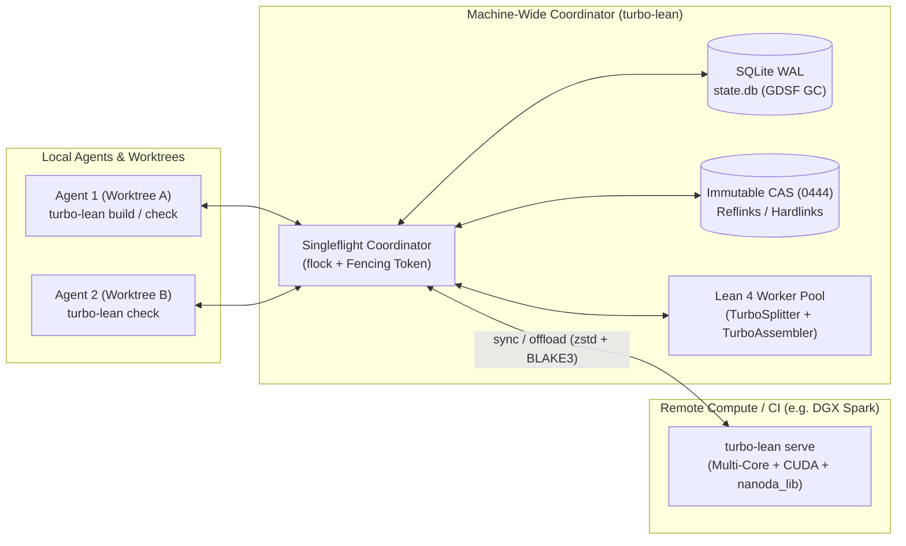

# turbo-lean

**High-performance, distributed build, verification, and counterexample tooling for Lean 4.**

`turbo-lean` is a machine-wide CLI, daemon, and content-addressed verification engine that accelerates interactive AI agent proof loops, multi-agent local concurrency, incremental CI, and trustless adversarial certification for any Lean 4 repository.

---

## Vision & Core Capabilities

1. **Sub-Second Agent Feedback (`check` & `fast-check`)**
   - **Warm Zygote / Prefix-Environment Worker Pool**: Keeps imported `.olean` graphs resident in OS `Shared_Clean` page cache and verifies single declarations or tactic edits in `< 50 ms` without spawning the `lake` parent process.
   - **Prefix-Scoped Theorem Sharding + Kernel `Expr` Replay (`TurboAssembler`)**: Splits multi-thousand-line Lean files into elaborated prefix environments and independent theorem shards, replaying verified kernel `Expr` proof terms via `Environment.addDecl` to emit genuine, `sorry`-free `.olean` artifacts up to **500x faster** on single-theorem edits.
   - **Native & GPU Counterexample Fast-Reject**: Rejects false candidate lemmas in microseconds using compiled Lean (`leanc -O3` Perceus/FBIP) or remote CUDA kernels (`CuDenote` / `CuMutate`) before wasting tactic heartbeats.

2. **Machine-Wide Zero-Redundancy Storage & Singleflight (`state.db` + CAS)**
   - **Local SQLite (WAL) Coordinator + Immutable CAS (`~/.cache/turbo-lean/`)**: Stores `.olean`, `.ilean`, `.c`, `.lean4export`, and kernel `Expr` shards by `BLAKE3` digest (`0444` immutable blobs), materialized into project worktrees via reflinks (`FICLONE`) or hardlinks (`linkat`) for `7.4x` lower multi-agent RAM.
   - **Transparent Multi-Agent Singleflight (`flock` + Fencing Tokens)**: Unaware agents working concurrently across separate worktrees or repositories automatically coalesce identical build/check actions via kernel `flock` locks—zero duplicate Lean compilations.
   - **Cost-Aware Multi-Project GC (`GDSF`)**: Tracks `reclaimable_bytes`, `worktree_retained_bytes`, and `pinned_bytes`, evicting cold artifacts by `duration_ms / size_bytes` while pruning stale worktree links.

3. **Two-Level Proof-Irrelevant Incremental CI & Cross-Arch Sync**
   - **Level 1 (`InterfaceCAS`)**: Hashes elaborated module signatures and definitions independently of `Prop` theorem proof bodies—editing a tactic proof never triggers downstream module rebuild cascades.
   - **Level 2 (`TheoremProofCAS`)**: Caches individual theorem proofs keyed by `(Toolchain, ModuleName, LeanOptions, PrefixEnvHash, StmtHash, ProofHash)`.
   - **Portable Cross-Architecture Sync & Heavy-Node Offload (`serve` / `sync` / `export`)**: Synchronizes architecture-independent `.olean` and `.lean4export` artifacts across `x86_64` and `aarch64` machines, and offloads CPU/GPU-heavy workloads to dedicated compute nodes (e.g., NVIDIA DGX Spark).

4. **Untrusted PR Sandboxing & Adversarial Certification (`ci-verify`)**
   - Isolates untrusted PR elaboration inside network-off, read-only overlay sandboxes (`bwrap`) and gates cache promotion on out-of-sandbox external Rust kernel verification (`nanoda_lib` at `>8M decls/s` / `lean4checker --fresh`) + strict axiom hygiene (`{propext, Quot.sound, Classical.choice}`).

---

## Architecture



## CLI Overview

```bash
turbo-lean build [target...]                # Two-level incremental build + Singleflight
turbo-lean check <file.lean> [--decl <id>]  # Fast declaration check via PrefixEnv + Zygote
turbo-lean fast-check <file.lean>           # Native / GPU counterexample search
turbo-lean status                           # Live CAS storage, RAM & Singleflight metrics
turbo-lean gc [--max-reclaimable 10G]       # Cost-aware GDSF garbage collection + dead worktree pruning
turbo-lean export -o cache.tlpack           # Export deduplicated zstd bundle (blobs + SQLite manifest)
turbo-lean import cache.tlpack              # Verify BLAKE3 digests and import into local CAS
turbo-lean sync <remote-url-or-ssh>         # Bidirectional delta sync across machines/architectures
turbo-lean serve [--listen 0.0.0.0:9400]    # Run remote offload & CAS server (CPU + GPU + nanoda_lib)
turbo-lean ci-verify [--mode untrusted]     # Sandboxed build + external kernel & axiom certification
```

## Repository Structure

- `crates/turbo-lean/` — Rust CLI, SQLite WAL coordinator, `flock` Singleflight, GDSF GC, `zstd` pack export/import, HTTP/SSH remote offload server, and external kernel verification gate.
- `lean/` — Lean 4 native frontend (`TurboSplitter`, `TurboAssembler`, `TurboWorker`, and verified reflection / fast-check harnesses).
- `gpu/` — CUDA 256-bit symbolic & mutation fast-reject kernels (`CuDenote` / `CuMutate`).
- `autoresearch/` — Automated benchmark & soundness harness enforcing zero false positives (`I1–I4`) while optimizing latency, memory (`PSS`), and cache hit rate across real commit histories.
