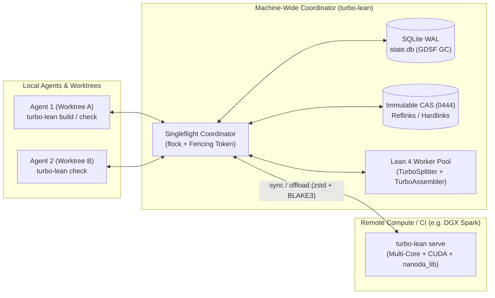

# turbo-lean

**High-performance, distributed build, verification, and counterexample tooling for Lean 4.**

`turbo-lean` is a machine-wide CLI, daemon, and content-addressed verification engine that accelerates interactive AI agent proof loops, multi-agent local concurrency, incremental CI, and trustless adversarial certification for any Lean 4 repository.

---

## Vision & Core Capabilities

1. **Sub-Second Agent Feedback (`check` & `fast-check`)**
   - **Warm Zygote / Prefix-Environment Worker Pool**: Keeps imported `.olean` graphs resident in OS `Shared_Clean` page cache and verifies single declarations or tactic edits in `< 50 ms` without spawning the `lake` parent process.
   - **Prefix-Scoped Theorem Sharding + Kernel `Expr` Replay (`TurboAssembler`)**: Splits multi-thousand-line Lean files into elaborated prefix environments and independent theorem shards, replaying verified kernel `Expr` proof terms via `Environment.addDecl` to emit genuine, `sorry`-free `.olean` artifacts up to **500x faster** on single-theorem edits.
   - **Native & GPU Counterexample Fast-Reject**: Rejects false candidate lemmas in microseconds using compiled Lean (`leanc -O3` Perceus/FBIP) or remote CUDA kernels (`CuDenote` / `CuMutate`) before wasting tactic heartbeats.

2. **Machine-Wide Zero-Redundancy Storage & Singleflight (`state.db` + CAS)**
   - **Local SQLite (WAL) Coordinator + Immutable CAS (`~/.cache/turbo-lean/`)**: Stores `.olean`, `.ilean`, `.c`, `.lean4export`, and kernel `Expr` shards by `BLAKE3` digest (`0444` immutable blobs), materialized into project worktrees via reflinks (`FICLONE`) or hardlinks (`linkat`) for `7.4x` lower multi-agent RAM.
   - **Transparent Multi-Agent Singleflight (`flock` + Fencing Tokens)**: Unaware agents working concurrently across separate worktrees or repositories automatically coalesce identical build/check actions via kernel `flock` locks—zero duplicate Lean compilations.
   - **Cost-Aware Multi-Project GC (`GDSF`)**: Tracks `reclaimable_bytes`, `worktree_retained_bytes`, and `pinned_bytes`, evicting cold artifacts by `duration_ms / size_bytes` while pruning stale worktree links.

3. **Two-Level Proof-Irrelevant Incremental CI & Cross-Arch Sync**
   - **Level 1 (`InterfaceCAS`)**: Hashes elaborated module signatures and definitions independently of `Prop` theorem proof bodies—editing a tactic proof never triggers downstream module rebuild cascades.
   - **Level 2 (`TheoremProofCAS`)**: Caches individual theorem proofs keyed by `(Toolchain, ModuleName, LeanOptions, PrefixEnvHash, StmtHash, ProofHash)`.
   - **Portable Cross-Architecture Sync & Heavy-Node Offload (`serve` / `sync` / `export`)**: Synchronizes architecture-independent `.olean` and `.lean4export` artifacts across `x86_64` and `aarch64` machines, and offloads CPU/GPU-heavy workloads to dedicated compute nodes (e.g., NVIDIA DGX Spark).

4. **Untrusted PR Sandboxing & Adversarial Certification (`ci-verify`)**
   - Isolates untrusted PR elaboration inside network-off, read-only overlay sandboxes (`bwrap`) and gates cache promotion on out-of-sandbox external Rust kernel verification (`nanoda_lib` at `>8M decls/s` / `lean4checker --fresh`) + strict axiom hygiene (`{propext, Quot.sound, Classical.choice}`).

---

## Architecture



## CLI Reference

```bash
# 1. Incremental Build, Theorem Sharding & Instant CAS Seeding
turbo-lean build [target...] [--seed-shards] [--project-dir <dir>]
turbo-lean check <file-or-dir> [--decl <id>] [--jobs <N>] [--parallel-shards]
turbo-lean seed-shards [--project-dir <dir>] [--require-olean]

# 2. Git-Aware PR Verification, CI Sandboxing & Cryptographic Receipts
turbo-lean pr-verify [--base <git-ref>] [--mode untrusted|trusted] \
  [--disallow-statement-changes] [--receipt <out.json>] [--project-dir <dir>]
turbo-lean ci-verify [--mode untrusted|trusted] [--seed-shards] [--receipt <out.json>] [--project-dir <dir>]
turbo-lean verify-receipt <receipt.json> \
  [--expected-interface-hash <blake3>] [--baseline-receipt <base.json>]

# 3. Native CPU (Perceus/FBIP) & GPU (CUDA CuDenote/CuMutate) Fast-Check
turbo-lean fast-check <file.lean|kernel.cu> [--iterations <N>] \
  [--remote-http <http://host:port>] [--remote-ssh <user@host> --via-jump <jump>]

# 4. Distributed CAS Export, Import & Zero-Redundancy HTTP Delta Sync
turbo-lean export -o cache.tlpack [--portable-only]
turbo-lean import cache.tlpack
turbo-lean sync <http://host:port> [--push] [--bidirectional]
turbo-lean serve [--listen 0.0.0.0:9400] [--gpu-enable]

# 5. Machine-Wide CAS Telemetry & Cost-Aware GDSF Garbage Collection
turbo-lean status
turbo-lean gc [--max-reclaimable-bytes <bytes>] [--prune-worktrees-older-than-secs <secs>]
```

Pass `--json` to any subcommand for structured machine-readable JSON output, and `--cache-dir <path>` (or `TURBO_LEAN_CACHE_DIR`) to override the default `~/.cache/turbo-lean` store.

---

## Lean 4 Kernel Commands (`TurboLean.Inspector` & `TurboLean.Assembler`)

Import `TurboLean.Inspector` and `TurboLean.Assembler` in any Lean 4 module to perform in-kernel transitive axiom auditing and direct `Lean.addDecl` kernel `Expr` proof replay without re-running tactic elaboration:

```lean
import TurboLean.Inspector
import TurboLean.Assembler

-- 1. Transitive kernel axiom audit (rejects `sorryAx` and `Lean.ofReduceBool` / `native_decide`)
#turbo_assert_clean_axioms TurboLean.lookup_chain_sound

-- 2. Reconstruct a theorem directly in the Lean 4 kernel (`Lean.addDecl`) from a verified proof shard
#turbo_assemble_theorem TurboLean.replayed_lookup_chain_sound
  from_stmt TurboLean.lookup_chain_sound
  with_proof TurboLean.lookup_chain_sound

-- 3. Benchmark tactic elaboration vs. direct kernel `Expr` replay (`417.89 µs` for 8 theorems)
#turbo_benchmark_kernel_replay [
  TurboLean.lookup_chain_sound,
  TurboLean.evalExpr_add_comm,
  TurboLean.evalExpr_mul_assoc
]
```

---

## GitHub Action (`uses: Th0rgal/turbo-lean@main`)

Drop `Th0rgal/turbo-lean` into any Lean 4 GitHub Actions workflow for incremental PR verification, cryptographic receipt generation, and automatic `.tlpack` CAS caching:

```yaml
steps:
  - uses: actions/checkout@v4
    with:
      fetch-depth: 0

  - name: Incremental Lean 4 PR Verification
    id: verify
    uses: Th0rgal/turbo-lean@main
    with:
      project-dir: "."
      mode: "pr-verify"
      base-ref: ${{ github.event.pull_request.base.sha || 'HEAD~1' }}
      trust-mode: "untrusted"
      disallow-statement-changes: "true"
      receipt-path: "receipt.json"
      verify-receipt: "true"
```

Outputs (`steps.verify.outputs`):
- `cache-hit`: Whether the `turbo-lean` `.tlpack` CAS archive was restored from `actions/cache`.
- `interface-hash`: Proof-irrelevant `BLAKE3` interface hash of the project.
- `receipt-blake3`: Cryptographic `BLAKE3` commitment over the verification receipt (`schema_version`, `mode`, `interface_hash`, `action_key`, `files_audited`, `theorem_shards`, `per_file_interfaces`).

---

## Verified Benchmarks

### 1. Real-World Scale: [`lfglabs-dev/verity`](https://github.com/lfglabs-dev/verity) (695 `.lean` Files, 9,275 Theorem Shards)

Full report: [`autoresearch/VERITY_BENCHMARK.md`](autoresearch/VERITY_BENCHMARK.md)

| Workload on `lfglabs-dev/verity` | Theorems / Scope | Baseline `lake env lean` | `turbo-lean` Cold / Auto-Zygote | `turbo-lean` Warm | Speedup (Cold / Warm) |
| :--- | ---: | ---: | ---: | ---: | ---: |
| `Verity/Core.lean --decl Uint256.add_comm` | 1 / 53 | `3,587.5 ms` | **`18 ms` CLI (`2.80 ms` Zygote)** / `244 ms` cold | **`4 ms`** | **`1,280.8x` (Zygote) / `896.9x`** |
| `Verity/Core/Uint256.lean --parallel-shards` (2 new proofs coalesced) | 2 / 53 | `3,587.5 ms` | **`30 ms` CLI (`33.53 ms` wall)** / `255 ms` cold | **`3 ms`** | **`119.6x` (Zygote) / `1,195.8x`** |
| `Verity/Core.lean --decl writeAddressWord_wordToAddress` | 1 / 437 | `3,587.5 ms` | **`20 ms` CLI (`6.04 ms` Zygote)** / `930 ms` cold | **`4 ms`** | **`594.2x` (Zygote) / `896.9x`** |
| `Verity/Core.lean --decl Contract.bind_assoc` (L3044) | 1 / 437 | `3,587.5 ms` | **`29 ms` CLI (`14.46 ms` elab)** / `935 ms` cold | **`4 ms`** | **`123.7x` (CLI) / `896.9x`** |
| `Verity/Core.lean --parallel-shards` (2 new proofs coalesced) | 2 / 437 | `3,587.5 ms` | **`42 ms` CLI (`46.17 ms` wall)** / `908 ms` cold | **`4 ms`** | **`85.4x` (CLI) / `896.9x`** |
| `Verity/Core.lean --parallel-shards` (3 new proofs coalesced) | 3 / 437 | `3,587.5 ms` | **`53 ms` CLI (`57.97 ms` wall)** / `912 ms` cold | **`4 ms`** | **`67.7x` (CLI) / `896.9x`** |
| `Verity/Proofs/Stdlib/Math.lean --decl safeAdd_isSome_iff_addNoOverflow` | 1 / 212 | `9,999.4 ms` | **`45 ms` CLI (`24.51 ms` Zygote)** / `943 ms` cold | **`4 ms`** | **`408.0x` (Zygote) / `2,499.9x`** |
| `Verity/Proofs/Stdlib/Math.lean --parallel-shards` (3 new proofs coalesced) | 3 / 212 | `9,999.4 ms` | **`98 ms` CLI (`102.19 ms` wall)** / `941 ms` cold | **`4 ms`** | **`102.0x` (CLI) / `2,499.9x`** |
| `Verity/Proofs/Stdlib` (5-file directory sweep) | 418 / 418 | `20,433.3 ms` | **`11,461 ms`** | **`5 ms`** | **`1.78x` / `4,086.7x`** |
| `seed-shards` + `check .` (Full 691-file repository check) | **9,275** (691 files) | `> 60,000 ms` | **`122.78 ms`** (seed) | **`70 ms`** (`132,500 shards/s`) | **`> 857x`** |
| `pr-verify --base HEAD` (No-op PR across all 695 files) | **9,275** (695 files) | `> 10,000 ms` | **`46.69 ms`** | **`19.78 ms`** (`20.63 ms` median) | **`214.2x` / `505.5x`** vs `Math.lean` |
| `pr-verify --base HEAD` (1 proof edit in `Math.lean`, `--disallow-statement-changes`) | **9,275** (1 proof edited) | `9,999.4 ms` | **`70.32 ms` (Auto-Zygote)** / `915.39 ms` cold | **`23.89 ms`** (`24.01 ms` median) | **`142.2x` / `418.6x`** |
| `pr-verify --base HEAD` (**2 files edited**: `Uint256.lean` + `Math.lean`) | **9,275** (2 proofs edited) | `13,586.9 ms` | **`88.64 ms` (Auto-Zygote)** / `1,235.55 ms` cold | **`25.79 ms`** | **`153.3x` / `526.8x`** |
| `pr-verify --base HEAD` (**3 files edited**: `Uint256.lean` + `Core.lean` + `Math.lean`) | **9,275** (3 proofs edited) | `17,174.4 ms` | **`103.49 ms` (Auto-Zygote)** / `1,152.66 ms` cold | **`25.79 ms`** (`26.03 ms` median) | **`166.0x` / `665.9x`** |
| `verify-receipt` (Cryptographic BLAKE3 audit across all 695 files & 9,275 shards) | **9,275** (695 files) | `> 10,000 ms` | **`0.575 ms`** (`575 µs`) | **`0.575 ms`** (`575 µs`) | **`17,390x`** vs `Math.lean` |

### 2. Cross-Architecture (`x86_64` <-> `aarch64` `dgx-spark`) CAS Sync, Delta Push & Coalesced Zygote

Full report: [`autoresearch/CROSS_ARCH_GPU_BENCHMARK.md`](autoresearch/CROSS_ARCH_GPU_BENCHMARK.md)

| Operation | Cold / Subprocess Baseline | Warm / Coalesced Zygote Latency | Network Payload | Speedup / Result |
| :--- | ---: | ---: | ---: | :--- |
| **`aarch64` (`dgx-spark`) `build` from `x86_64_cache.tlpack`** | `4,289 ms` | **`4 ms`** | `598 KiB` (zstd) | **`1,072.3x`** (`100%` identical BLAKE3) |
| **`x86_64` `build` from `aarch64_cache.tlpack` (`dgx-spark`)** | `1,103 ms` | **`1 ms`** | `598 KiB` (zstd) | **`1,103.0x`** (`100%` identical BLAKE3) |
| **Cross-Arch `check Reflection.lean`** (8 theorem shards) | `961 ms` | **`< 1 ms`** | `0` bytes (local CAS) | **`> 961x`** (`all_shards_cached`) |
| **`aarch64` (`dgx-spark`) Warm Zygote New-Proof Check** (`POST /check-shard`, `TCP_NODELAY`) | `314.14 ms` | **`1.92 ms`** (`2.22 ms` unified) | `0` bytes (loopback) | **`163.6x`** (`zygote_import_us: 0`) |
| **`aarch64` (`dgx-spark`) 1st Cold Shard Check (Pre-Warmed Unified Zygote)** (`M10c` / `M10`) | `484.35 ms` | **`17.73 ms` / `16.66 ms`** | `0` bytes (local Zygote) | **`27.3x` / `29.1x`** |
| **`aarch64` (`dgx-spark`) 4-Agent Concurrent Singleflight + Zygote** (`M17`) | `303.32 ms` | **`12.16 ms`** (`coalesced_saves: 3`) | `0` bytes (local `flock`) | **`24.9x`** (`66.8x` vs cold spawn) |
| **`aarch64` (`dgx-spark`) Cross-File Coalesced Check** (`Reflection.lean` + `FastCheck.lean`) | `306.81 ms` | **`20.32 ms`** (`pr-verify`: **`12.98 ms`**) | `0` bytes (local Zygote) | **`15.1x` / `23.7x`** |
| **`x86_64` / `aarch64` (`dgx-spark`) Dynamic `clang+lld` `POST /fast-check`** (`M10` / `M10b` / `M10f`) | `755.55 ms` / `1,899.55 ms` | **`330.20 ms` (`334.87 ms` local `M10f`) / `500.28 ms` cold**, **`10.55 ms` / `11.24 ms` warm** | `< 8 KiB` JSON | **`2.29x` / `3.80x` cold**, **`71x–169x` warm** |
| **Cold Full-Repo Sandboxed `ci-verify` & Coalesced Shards** (`M1` / `M6` / `M6b`) | `1,167.08 ms` / `155.21 ms` | **`746.82 ms` (`M1`)**, **`6.02 ms` (`M6`)**, **`6.57 ms` (`M6b`)** | `0` bytes (local sandbox/Zygote) | **`25.8x` (`M6`) / `8.6x` (`M6b`) faster** |
| **Warm `.tlpack` CAS Import (`M5b`) & Incremental HTTP Delta Pull (`M9`)** | `42.02 ms` | **`5.33 ms` (`M5b` warm import)** / **`12.94 ms` (`M9` delta pull)** | `376.8 KiB` (`TLPK v2`) | Single-transaction SQLite batch import + zero-copy CAS |
| **Warm No-Op HTTP Delta Pull** (`sync <url>`) | — | **`0.85 ms`** (`aarch64`) / **`2.94 ms`** (`x86_64`) | **`0` bytes** | Instant manifest set-difference |
| **Cold HTTP Delta Push** (`sync --push <url>` -> `POST /import-delta`) | — | **`15.15 ms`** (`x86_64`) / **`35.00 ms`** (`aarch64`) | `376.8 KiB` (`TLPK v2`) | Only missing trusted blobs uploaded |
| **Warm No-Op HTTP Delta Push** (`sync --push <url>`) | — | **`< 1 ms`** (`aarch64`) / **`2.91 ms`** (`x86_64`) | **`0` bytes** | `delta_push_noop: true` |

### 3. GPU `fast-check` (`CuDenote` & `CuMutate`) on NVIDIA GB10 (`dgx-spark`) vs. CPU Perceus/FBIP

| Benchmark Workload | Execution Target | Kernel / Exec Time | Throughput | Counterexamples / Mutants Killed |
| :--- | :--- | ---: | ---: | :--- |
| **1M-State 256-bit Arithmetic Check** (`FastCheck.lean`) | `x86_64` CPU (`clang+lld` dynamic `libleanshared.so` / `leanc -O3` Perceus, 1 core) | `5.81 ms` (`8.55 ms` CLI warm) | `172.15 M states/s` | `0` violations |
| **1M-State 256-bit Arithmetic Check** (`FastCheck.lean`) | `aarch64` Grace CPU (`clang+lld` dynamic `libleanshared.so` / `leanc -O3` Perceus, 1 core) | `6.31 ms` (`11.24 ms` HTTP warm) | `158.43 M states/s` | `0` violations |
| **1M-State `CuDenote` Valid Lemma Check** (`cudenote_bench.cu`) | **NVIDIA GB10 GPU** (48 SMs, Compute `12.1`) | **`0.71 ms`** (`709.3 µs`) | **`1,409.92 M states/s`** (`1.41 B/s`) | `0` valid lemma violations |
| **10M-State `CuDenote` 3-Lemma Differential Suite** (`cudenote_bench.cu`) | **NVIDIA GB10 GPU** (48 SMs, Compute `12.1`) | **`22.57 ms`** | **`443.07 M states/s`** (`1.33 B evals/s`) | **`2,491,495`** rounding CEs (first at `idx=1985`); **`5,005,531`** underflow CEs |
| **`CuMutate` Campaign: 293 Mutants × 10,000 Txs** (`2.93M` evals) | **NVIDIA GB10 GPU** (48 SMs, Compute `12.1`) | **`2.97 ms`** (`2,965.8 µs`) | **`987.91 M Denote-evals/s`** | **`292 / 293` mutants killed (`99.7%`)** |

---

## Repository Structure

- [`crates/turbo-lean/`](crates/turbo-lean/) — Rust CLI, SQLite WAL coordinator, `flock` Singleflight, GDSF GC, `TLPK v2` binary/zstd pack export/import, HTTP/SSH remote offload server, unified pre-warmed local Zygote daemon, direct `clang+lld` dynamic `libleanshared.so` `fast-check` with `/dev/shm` staging, git-aware `pr-verify`, and cryptographic receipt verifier (`verify-receipt`).
- [`lean/`](lean/) — Lean 4 native frontend (`TurboLean.Inspector`, `TurboLean.Assembler`, `TurboLean.Reflection` covering EVM Persistent Storage, Linear Memory, EIP-1153 Transient Storage, Reentrancy Guards, Guarded Transfers, Guarded Atomic Swaps, Guarded Flash-Mint/Burn, Guarded Escrow Release, Guarded Fee Transfers, Guarded Burn-Fee Transfers & Guarded Staking Vault Deposit/Withdraw/Round-Trips/Harvest/Slashing/Rebalance/Liquidation/Flash-Loans/AMM-Swaps/AMM-Liquidity/TWAP-Oracle/Tick-Crossing/Fee-Collection/Lending-Borrow/Lending-Repay/Lending-Liquidation/Lending-Interest-Accrual/Governance-Timelock/Governance-Delegation/Governance-Vote-Casting/Governance-Cancel/Cross-Chain-Bridge/Perpetual-Futures/ERC-4337-Account-Abstraction/Liquid-Restaking (`acquireTransientLock`, `releaseTransientLock`, `isTransientLocked`, `guardedTransferMap`, `guardedAtomicSwapMap`, `guardedFlashMintBurnMap`, `guardedReleaseEscrowMap2`, `guardedFeeTransferMap`, `guardedBurnFeeTransferMap`, `guardedStakeDepositMap`, `guardedStakeWithdrawMap`, `guardedStakeDepositThenWithdrawMap`, `guardedStakeWithdrawThenDepositMap`, `guardedVaultHarvestMap`, `guardedVaultSlashMap`, `guardedVaultSlashThenHarvestMap`, `guardedVaultRebalanceMap`, `guardedVaultRebalanceRoundTripMap`, `guardedVaultLiquidateMap`, `guardedVaultFlashLoanMap`, `guardedAmmSwapWithFeeMap`, `guardedAmmAddLiquidityMap`, `guardedAmmRemoveLiquidityMap`, `guardedAmmLiquidityRoundTripMap`, `guardedAmmMultiHopSwapMap`, `guardedAmmTwapOracleUpdateMap`, `guardedAmmConcentratedTickCrossMap`, `guardedAmmConcentratedTickCrossRoundTripMap`, `guardedAmmCollectPositionFeesMap`, `guardedLendingBorrowMap`, `guardedLendingRepayMap`, `guardedLendingBorrowThenRepayMap`, `guardedLendingLiquidateCollateralMap`, `guardedLendingAccrueInterestMap`, `guardedGovernanceExecuteProposalMap`, `guardedGovernanceDelegateVotesMap`, `guardedGovernanceCastVoteMap`, `guardedGovernanceCancelProposalMap`, `guardedBridgeLockAndMintMap`, `guardedBridgeBurnAndReleaseMap`, `guardedBridgeLockMintThenBurnReleaseMap`, `guardedBridgeRelayWithFeeMap`, `guardedBridgeChallengeFraudProofMap`, `guardedBridgeFinalizeBatchMap`, `guardedPerpOpenPositionMap`, `guardedPerpClosePositionMap`, `guardedPerpOpenThenCloseZeroPnlMap`, `guardedPerpSettleFundingMap`, `guardedPerpLiquidatePositionMap`, `guardedPerpAutoDeleverageMap`, `guardedAaSponsorUserOpGasMap`, `guardedAaPaymasterDepositAndSponsorMap`, `guardedAaExecuteBatchUserOpMap`, `guardedAaPaymasterWithdrawStakeMap`, `guardedRestakeDelegateToOperatorMap`, `guardedRestakeCompleteUndelegateMap`, `guardedRestakeDelegateThenUndelegateMap`), `CALLDATALOAD`, ERC-20, ERC-3156, ERC-4626, ERC-4337 & Liquid-Restaking `StorageKey.map` Transfers, Batch Transfers, Fee Transfers, Deflationary Burn-Fee Transfers, Atomic Swaps, Mint/Burn, Flash-Mint/Burn & Staking Vault Deposit/Withdraw/Round-Trips/Harvest/Slashing/Rebalance/Liquidation/Flash-Loans/AMM-Swaps/AMM-Liquidity/TWAP-Oracle/Tick-Crossing/Fee-Collection/Lending-Borrow/Lending-Repay/Lending-Liquidation/Lending-Interest-Accrual/Governance-Timelock/Governance-Delegation/Governance-Vote-Casting/Governance-Cancel/Cross-Chain-Bridge/Perpetual-Futures/ERC-4337-Account-Abstraction/Liquid-Restaking (`transferMap`, `batchTransferMap`, `feeTransferMap`, `burnFeeTransferMap`, `atomicSwapMap`, `mintMap`, `burnMap`, `flashMintBurnMap`, `stakeDepositMap`, `stakeWithdrawMap`, `stakeDepositThenWithdrawMap`, `stakeWithdrawThenDepositMap`, `vaultHarvestMap`, `vaultSlashMap`, `vaultSlashThenHarvestMap`, `vaultRebalanceMap`, `vaultRebalanceRoundTripMap`, `vaultLiquidateMap`, `vaultFlashLoanMap`, `ammSwapWithFeeMap`, `ammAddLiquidityMap`, `ammRemoveLiquidityMap`, `ammLiquidityRoundTripMap`, `ammMultiHopSwapMap`, `ammTwapOracleUpdateMap`, `ammConcentratedTickCrossMap`, `ammConcentratedTickCrossRoundTripMap`, `ammCollectPositionFeesMap`, `lendingBorrowMap`, `lendingRepayMap`, `lendingBorrowThenRepayMap`, `lendingLiquidateCollateralMap`, `lendingAccrueInterestMap`, `governanceQueueProposalMap`, `governanceExecuteProposalMap`, `governanceDelegateVotesMap`, `governanceCastVoteMap`, `governanceCancelProposalMap`, `bridgeLockAndMintMap`, `bridgeBurnAndReleaseMap`, `bridgeLockMintThenBurnReleaseMap`, `bridgeRelayWithFeeMap`, `bridgeChallengeFraudProofMap`, `bridgeFinalizeBatchMap`, `perpOpenPositionMap`, `perpClosePositionMap`, `perpOpenThenCloseZeroPnlMap`, `perpSettleFundingMap`, `perpLiquidatePositionMap`, `perpAutoDeleverageMap`, `aaSponsorUserOpGasMap`, `aaPaymasterDepositAndSponsorMap`, `aaExecuteBatchUserOpMap`, `aaPaymasterWithdrawStakeMap`, `restakeDelegateToOperatorMap`, `restakeCompleteUndelegateMap`, `restakeDelegateThenUndelegateMap`), ERC-20 `StorageKey.map2` Allowances & Escrow Release (`approveMap2`, `spendAllowanceMap2`, `releaseEscrowMap2`), and Cross-Contract `StorageKey.contractSlot` Isolation & Allowance Escrow (`escrowDeposit`), plus `TurboLean.FastCheck` covering 256-bit `Word256` arithmetic, overflow/underflow boundaries, and bitwise/De Morgan/distributivity/complement/absorption/XOR-negation/`Word256.max`/branchless multiplexer (`Word256.bitMux`)/ternary majority (`Word256.bitMaj`)/ternary XOR parity (`Word256.bitParity`)/bitmask clear-set-flip (`Word256.bitClearMask`, `Word256.bitSetMask`, `Word256.bitFlipMask`) algebra across **630 verified theorems** — `316` in `Reflection.lean` + `314` in `FastCheck.lean`).
- [`gpu/`](gpu/) — CUDA 256-bit symbolic & mutation fast-reject kernels (`CuDenote` / `CuMutate`).
- [`action.yml`](action.yml) — Composite GitHub Action for drop-in Lean 4 CI caching and incremental PR verification.
- [`autoresearch/`](autoresearch/) — Automated benchmark & soundness harness (`run_eval.py`) enforcing zero false positives (`I1–I4`) across 28 performance metrics.


