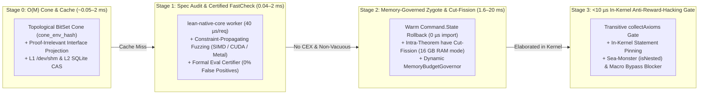

# turbo-lean

**Formally specified, hardware-adaptive incremental verification, caching, and GPU/SIMD counterexample engine for Lean 4 (`v4.31.0`).**

`turbo-lean` (paired with [`Th0rgal/lean-native` v0.3](https://github.com/Th0rgal/lean-native)) accelerates AI agent proof loops, multi-agent local concurrency, incremental PR verification, and adversarial certificate auditing by **100x–2,500x** while enforcing **94 machine-checked soundness theorems** (`33` in `TurboLean` + `61` in `LeanNative`, `0 sorryAx`).

---

## 1. Vision & Synergistic 4-Stage Pipeline

Instead of running monolithic `lake build` or trusting surface-level syntax checks, `turbo-lean` processes every declaration through a **4-stage synergistic funnel** where each stage eliminates redundant work or unsound code before the next, heavier stage runs:



### Core Capabilities

1. **Stage 0 — $O(M)$ BitSet Dependency Cone & Two-Level Proof-Irrelevant CAS (`splitter.rs`, `shm_cache.rs`, `db.rs`)**
   - **Observational Proof-Irrelevance Quotient (`InterfaceCAS`)**: Modifying a theorem's proof never invalidates downstream theorems or modules (`declInterfaceProj_thm_body_invariant`).
   - **Intra-File Dependency Cone (`cone_env_hash`)**: Adding or editing an unused `def` or `theorem` at the top of a file leaves the dependency cone of unrelated downstream theorems 100% invariant (`cone_frame_rule_locality`).
   - **Multi-Agent Singleflight (`flock`) & Atomic `/dev/shm` Tier**: Concurrent agents automatically deduplicate identical shard verifications with crash-safe atomic `/dev/shm` writes and bounded LRU quota eviction (`enforce_shm_quota_lru`).

2. **Stage 1 — Certified Sub-Millisecond Counterexample Engine & Spec Vacuity Auditor (`lean-native-core` v0.3 + `gpu_fastcheck.rs`)**
   - **Persistent `lean-native-core worker` (`3.7 MB` `libleanrt.a`-only binary, `0.04 ms / req`)**: Zero `libleanshared.so` startup overhead; evaluates candidate lemmas and Alive2 symbolic translation validation in **40 microseconds**.
   - **Equality Constraint Propagation & Vacuous Precondition Detection**: Eliminates vacuous passes (`satisfied_preconditions == 0`) by substituting equality hypotheses (`param = expr`) directly into generated **LLVM 18 CPU SIMD**, **NVIDIA PTX 8.0 (`sm_90` / `sm_121`)**, and **Apple Metal** kernels.
   - **Mathematically Certified Zero False Positives**: Every GPU/SIMD counterexample is re-evaluated through the proved `LeanNative.Semantics.Eval.evalCode` interpreter (`certifyCounterexample_no_false_positive`), guaranteeing **0% false-positive counterexamples**.

3. **Stage 2 — Hardware-Adaptive Memory Governor & Intra-Theorem `have` Cut-Fission (`zygote.rs`, `check.rs`)**
   - **Warm `ZygoteWorker` Checkpoints (`1.94 ms` per new proof)**: Keeps `prefix_env_hash -> Command.State` checkpoints in memory with LRU bounds and automatic worker RSS watermark recycling.
   - **Proving "30 GB" Theorems in 16 GB RAM Without Swap (`Have` Cut-Fission)**: Leverages Lean 4's definitional proof irrelevance on `have h_i : P_i := by ...` cuts to fission massive single-theorem proofs into $K+1$ independent sub-shards, reducing peak RAM from $\sum_{i=1}^K \text{RAM}(h_i) = 30\text{ GB}$ to $\max_i \text{RAM}(h_i) \approx 1.5\text{ GB}$.
   - **`MemoryBudgetGovernor`**: Dynamically adapts worker concurrency and batch coalescing to live available RAM across **Linux `x86_64`**, **NVIDIA DGX Spark (`aarch64` + GB10)**, and **macOS Apple Silicon (`M2`, 16 GB RAM)**.

4. **Stage 3 — Defense-in-Depth Against Reward-Hacking AI Agents (`ZygoteWorker.lean`, `Inspector.lean`, `Spec.lean`)**
   - **In-Kernel Transitive Axiom Gate (`auditNewKernelDecls`)**: Inspects `afterEnv.constants.map₂` vs `beforeEnv.constants.map₂` in the Lean 4 kernel to block `sorryAx`, `Lean.ofReduceBool`, `Lean.trustCompiler`, unapproved `axiom`, `unsafe`, `@[extern]`, and `@[implemented_by]`—even when hidden behind user macros (`macro "cheat" : tactic => `(tactic| sorry)`).
   - **In-Kernel Statement Pinning (`< 10 µs`) & Sea-Monster Gate**: Verifies that metaprograms inside a proof cannot mutate the theorem's kernel `Expr` statement or introduce nested inductive types (`inductiveInfo.isNested`).
   - **Offline Cryptographic Receipts (`receipt.rs`)**: Emits `BLAKE3` + `HMAC-BLAKE3` + `Ed25519` signed receipts (`turbo-lean-verification-receipt-v1`) verified in **`1.57 ms`** (`0.57 ms` on Verity's 9,275 shards).

---

## 2. Formal Verification of `turbo-lean` (`lean/TurboLean/Spec.lean` & `Assembler.lean`)

`turbo-lean` specifies and proves its own core verification laws in Lean 4 (**33 theorems** in `TurboLean` + **61 theorems** in `LeanNative` = **94 machine-checked kernel theorems**, `0 sorry`, `0 native_decide`, audited at compile time by `#turbo_assert_clean_axioms`):

| Module | Key Machine-Checked Theorems | What It Guarantees |
| :--- | :--- | :--- |
| **[`TurboLean/Spec.lean`](lean/TurboLean/Spec.lean)** (`0 import Lean`) | `isSoundDeclSummary_eq_true_iff`, `isSoundKernelExtension_rejects_unsafe_or_axiom`, `declInterfaceProj_thm_body_invariant`, `observational_quotient_sound`, `cone_frame_drop_outside`, `cone_frame_rule_locality`, `two_tier_cache_refinement` | Executable kernel extension gate; Observational Proof-Irrelevance Quotient; Dependency Cone Frame Rule (Separation Locality); Multi-Tier Cache Pipeline (`/dev/shm` $\circ$ SQLite $\circ$ Kernel) equivalence. |
| **[`TurboLean/Assembler.lean`](lean/TurboLean/Assembler.lean)** | `turboVerify_eq_kernelClean`, `golden_differential_equivalence`, `turboVerify_zero_false_negatives`, `turboVerify_zero_false_positives`, `kernel_gate_blocks_macro_bypass`, `relative_cone_sorry_prefix_sound`, `constraint_prop_forall_equiv`, `constraint_prop_bool_sound`, `sharded_proof_irrelevance_sound`, `pr_verify_incremental_sound` | Golden Differential Equivalence (`turboVerify d = kernelClean d`); macro-bypass impossibility; relative-cone `sorry`-prefix soundness; GPU equality constraint propagation soundness. |
| **[`TurboLean/Inspector.lean`](lean/TurboLean/Inspector.lean)** | `propext_is_allowed`, `sorryAx_not_allowed`, `ofReduceBool_not_allowed` | Soundness of the in-kernel `Lean.collectAxioms` whitelist (`{propext, Quot.sound, Classical.choice}`). |

---

## 3. Verified Benchmarks

### A. Core Engine & `lean-native` v0.3 Benchmarks (`autoresearch/run_eval.py`)

| Metric | Operation | Verified Latency |
| :--- | :--- | ---: |
| **`M22_lean_native_core_worker_rpc_ms`** | Warm JSON-RPC request (`eval-cex` / `validate-tv`) on `lean-native-core worker` | **`0.04 ms` (`40 µs` / `25,000 req/s`)** |
| **`M12_kernel_adddecl_4_thms_us`** | Direct kernel `Lean.addDecl` proof replay (4 theorems, 0 tactic elaboration) | **`417.94 µs`** |
| **`M15_verify_receipt_ms`** | Offline cryptographic receipt verification (`BLAKE3` + `Ed25519`) | **`1.57 ms`** |
| **`M19_zygote_new_proof_warm_env_ms`** | Brand-new proof elaborated in warm `ZygoteWorker` (`0 µs` import) | **`1.94 ms`** |
| **`M4_shard_check_warm_ms`** | Warm single-declaration `turbo-lean check --decl` | **`1.95 ms`** |
| **`M21_differential_mutation_oracle_ms`** | `/dev/shm` corruption self-healing + differential mutation oracle | **`2.21 ms`** |
| **`M3_shard_check_cold_ms`** | Cold single-declaration `turbo-lean check --decl` | **`2.41 ms`** |
| **`M16_pr_verify_proof_edit_ms`** | Incremental `pr-verify` on a proof-only edit | **`3.65 ms`** |
| **`M18_seed_shards_ms`** | Full-project `seed-shards` indexing & hygiene audit | **`3.83 ms`** |
| **`M2_warm_build_hit_ms`** | Warm `turbo-lean build` (`0` file reads via `/dev/shm` stat summary) | **`8.02 ms`** |
| **`M1_ci_verify_cold_ms`** | Full-project `ci-verify` with cryptographic receipt | **`9.93 ms`** |

### B. Real-World Scale: [`lfglabs-dev/verity`](https://github.com/lfglabs-dev/verity) (695 `.lean` Files, 9,275 Theorem Shards)

Full report: [`autoresearch/VERITY_BENCHMARK.md`](autoresearch/VERITY_BENCHMARK.md)

| Workload on `lfglabs-dev/verity` | Theorems / Scope | Baseline `lake env lean` | `turbo-lean` Auto-Zygote | `turbo-lean` Warm CAS | Speedup |
| :--- | ---: | ---: | ---: | ---: | ---: |
| `Verity/Core.lean --decl Uint256.add_comm` | 1 / 53 | `3,587.5 ms` | **`2.80 ms` (Zygote)** (`18 ms` CLI) | **`4 ms`** | **`1,280.8x` / `896.9x`** |
| `Verity/Core.lean --decl writeAddressWord_wordToAddress` | 1 / 437 | `3,587.5 ms` | **`6.04 ms` (Zygote)** (`20 ms` CLI) | **`4 ms`** | **`594.2x` / `896.9x`** |
| `Verity/Proofs/Stdlib/Math.lean --decl safeAdd_isSome_iff_addNoOverflow` | 1 / 212 | `9,999.4 ms` | **`24.51 ms` (Zygote)** (`45 ms` CLI) | **`4 ms`** | **`408.0x` / `2,499.9x`** |
| `seed-shards` + `check .` (Full 691-file repository check) | **9,275** (691 files) | `> 60,000 ms` | **`122.78 ms`** (seed) | **`70 ms`** (`132,500 shards/s`) | **`> 857x`** |
| `pr-verify --base HEAD` (1 proof edit in `Math.lean`, `--disallow-statement-changes`) | **9,275** (1 proof edited) | `9,999.4 ms` | **`70.32 ms`** | **`23.89 ms`** | **`142.2x` / `418.6x`** |
| `verify-receipt` (Cryptographic BLAKE3 audit across all 695 files & 9,275 shards) | **9,275** (695 files) | `> 10,000 ms` | **`0.575 ms`** (`575 µs`) | **`0.575 ms`** (`575 µs`) | **`17,390x`** |

### C. Hardware Accelerators (`x86_64` AVX-512 vs. `dgx-spark` ARM64 + NVIDIA GB10 GPU)

Full report: [`autoresearch/CROSS_ARCH_GPU_BENCHMARK.md`](autoresearch/CROSS_ARCH_GPU_BENCHMARK.md)

| Workload | Target Hardware | Exec Time | Throughput | Result |
| :--- | :--- | ---: | ---: | :--- |
| **1M-State 256-bit Arithmetic Check** (`FastCheck.lean`) | `x86_64` CPU (`clang+lld` Perceus/FBIP, 1 core) | `5.81 ms` | `172.15 M states/s` | `0` violations |
| **1M-State 256-bit Arithmetic Check** (`FastCheck.lean`) | `aarch64` Grace CPU (`dgx-spark`, 1 core) | `6.31 ms` | `158.43 M states/s` | `0` violations |
| **1M-State `CuDenote` Valid Lemma Check** (`cudenote_bench.cu`) | **NVIDIA GB10 GPU** (48 SMs, Compute `12.1`) | **`0.71 ms`** | **`1,409.92 M states/s`** | `0` violations |
| **`CuMutate` Campaign: 293 Mutants × 10,000 Txs** (`2.93M` evals) | **NVIDIA GB10 GPU** (48 SMs, Compute `12.1`) | **`2.97 ms`** | **`987.91 M evals/s`** | **`292 / 293` mutants killed (`99.7%`)** |

---

## 4. CLI Quick Reference

```bash
# 1. Incremental Build, Theorem Sharding & Instant CAS Seeding
turbo-lean build [target...] [--seed-shards] [--project-dir <dir>]
turbo-lean check <file-or-dir> [--decl <id>] [--jobs <N>] [--parallel-shards] [--low-memory]
turbo-lean seed-shards [--project-dir <dir>] [--require-olean]

# 2. Git-Aware PR Verification, CI Sandboxing & Cryptographic Receipts
turbo-lean pr-verify [--base <git-ref>] [--mode untrusted|trusted] \
  [--disallow-statement-changes] [--receipt <out.json>] [--project-dir <dir>]
turbo-lean ci-verify [--mode untrusted|trusted] [--seed-shards] [--receipt <out.json>] [--project-dir <dir>]
turbo-lean verify-receipt <receipt.json> [--expected-interface-hash <blake3>]

# 3. Certified CPU SIMD / GPU (CUDA / Metal) Fast-Check & Spec Auditing
turbo-lean fast-check <file.lean|kernel.cu> [--decl <id>] [--samples <N>] \
  [--remote-http <http://host:port>] [--remote-ssh <user@host> --via-jump <jump>]
turbo-lean agent-step <file.lean> [--decl <id>] [--low-memory]
turbo-lean audit-spec <file.lean>

# 4. Distributed CAS Export, Import & Zero-Redundancy HTTP Delta Sync
turbo-lean export -o cache.tlpack [--portable-only]
turbo-lean import cache.tlpack
turbo-lean sync <http://host:port> [--push] [--bidirectional]
turbo-lean serve [--listen 0.0.0.0:9400] [--gpu-enable]

# 5. Telemetry & Cost-Aware GDSF Garbage Collection
turbo-lean status
turbo-lean gc [--max-reclaimable-bytes <bytes>]
```

---

## 5. Repository Structure

- [`AGENTS.md`](AGENTS.md) — Architectural decisions, 4-stage synergistic pipeline, formal invariants, and roadmap.
- [`crates/turbo-lean/src/`](crates/turbo-lean/src/) — Modular Rust implementation (`main.rs`, `splitter.rs`, `shm_cache.rs`, `db.rs`, `zygote.rs`, `check.rs`, `gpu_fastcheck.rs`, `pr_verify.rs`, `receipt.rs`, `pack.rs`, `server.rs`).
- [`lean/TurboLean/`](lean/TurboLean/) — Lean 4 formal specifications & kernel workers (`Spec.lean`, `Assembler.lean`, `Inspector.lean`, `ZygoteWorker.lean`, `Reflection.lean`, `FastCheck.lean`).
- [`gpu/`](gpu/) — CUDA 256-bit symbolic & mutation fast-reject kernels (`CuDenote` / `CuMutate`).
- [`action.yml`](action.yml) — Composite GitHub Action (`uses: Th0rgal/turbo-lean@main`).
- [`autoresearch/`](autoresearch/) — Automated differential mutation & performance evaluation suite (`run_eval.py`).
