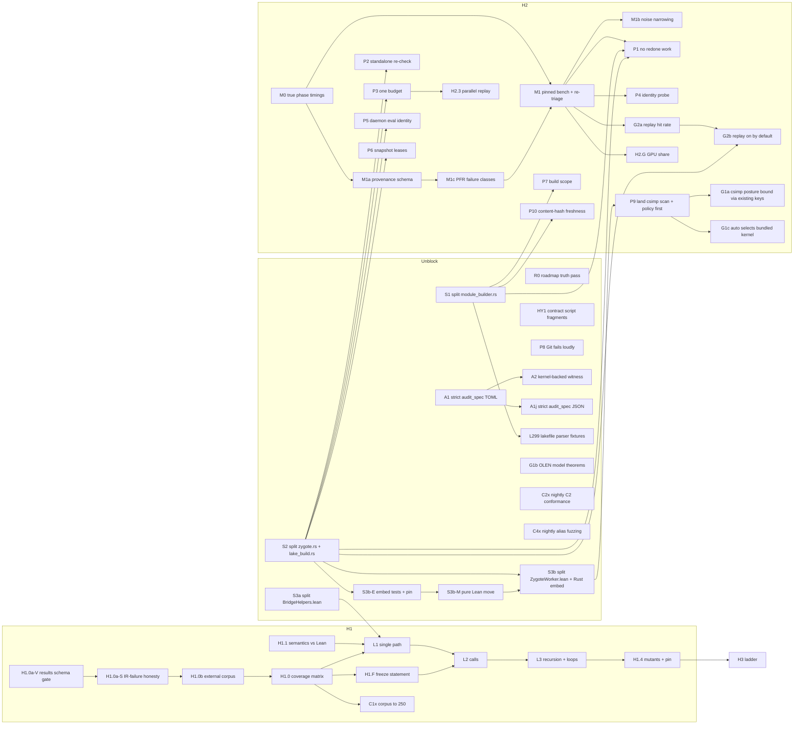

# Sequencing and work graph (`roadmap/HORIZONS.md`)

> **Scope**: the order in which the goals in [`GOALS.md`](./GOALS.md) are worked, as a dependency graph of leaf items that agents can take in parallel. It adds no theorem contract and changes none in [`VALIDATION_CONTRACTS.md`](./VALIDATION_CONTRACTS.md). Facts are from `main` at `94dbd70` (2026-11-15), reconciled to `main` at `fddf22c` (2026-11-16) by R0, then to `main` at `33810f5` (2026-11-16) by R0d (graph–table reconciliation, S3a/HY1 marked done, unresolved parent splits encoded), and from sources linked inline; they are point-in-time.

Source: Thomas's roadmap note of 2026-11-14 (prove Lean → IR first; build faster, hypothesis: pure-Lean kernel compiled by `LeanNative`, GPU if it pays; accelerator plugins last), then a feasibility review of the code and of published results on 2026-11-15. The review changed two of the three ideas; what changed is said where it applies.

| Horizon | Outcome | Status of the original idea |
| :--- | :--- | :--- |
| **H1** | One proven path from `LCNF` to `LNIR` for first-order code with calls and recursion, with a measured coverage number. | Kept, with a smaller exit. Compiling the pure-Lean kernel moves to H3. |
| **H2** | Faster agent loop and builds, measured end to end. | Kept. The native kernel and the GPU are no longer the levers. |
| **H3** | Runtime objects, closures, a native kernel as benchmark, accelerator plugins, remaining backends. | Kept, later. |

---

## What the review found

### The compiler (read from the code)

- **What is proved.** `lowerRealLCNFDecl_sound` (`Proofs/RealLCNFBridgeProofs.lean`): if lowering succeeds and the source evaluation succeeds, the `LNIR` evaluation gives the same result at the same fuel. It is about the function the driver calls, not a model of it.
- **What that covers.** One declaration at a time, no user calls, no recursion, scalars, flat tuples and small non-recursive inductives. A call to another user function is lowered, but the source semantics returns `unsupportedCall`, so the theorem says nothing about any declaration that makes one.
- **What surrounds it unproved.** About 1,100 LOC of `BridgeHelpers.lean` run before and after the proved function (context building, type lowering, an `LCNF` rewrite, post-passes). A second lowering (`lowerPureCode`, a `partial def`) is taken when a declaration has no impure form and has no proof at all. About 250 LOC of helpers are dead.
- **The source semantics is not independent.** `RealLCNFSemantics` imports the lowerer's file and shares its layout and type-lowering definitions.
- **The IR lacks the concepts, not only the lowering.** `evalCode` has no function environment; `Val` has no closure, big `Nat`, string or array of objects; `LNIRCode` has no join point or general loop. The LLVM driver refuses any reference-counted inductive.
- **Consequence.** `con-leche` uses recursive inductives, big `Nat`, arrays, hash maps, strings and `IO`. None of its declarations would lower today (its sources are pinned, not vendored, so this is inferred from its README).

### Build time (from published numbers)

- **The kernel is a small share.** The one full-Mathlib profile found gives typeclass inference 36.5%, `simp` 15.4%, kernel checking 4.7% ([Zulip, undated](https://leanprover-community.github.io/archive/stream/287929-mathlib4/topic/Ways.20to.20speed.20up.20Mathlib.html)). No authoritative 2026 breakdown was found.
- **Fast kernels already exist and ship.** Lean v4.35 bundles `con-leche`, `lean4lean` and `nanoda` behind `lake check --paranoid`. On Mathlib, `con-leche` reports 0.69× the official kernel's instructions and 100 s wall on 8 workers ([PERF.md](https://github.com/leanprover/con-leche/blob/master/PERF.md)).
- **Upstream already parallelizes.** Proof bodies, kernel checks and compilation run in parallel within a file; the module system stops private changes at the file boundary; Lake has a content-addressed remote cache ([FRO talk, 2026-04-24](https://lean-lang.org/presentations/20260424_INRIA/)). Still open upstream: incremental elaboration state on disk, starting downstream builds early.
- **GPU.** No result was found for GPU type checking or proof checking. The credible GPU results nearby are in optimization search (e-graph extraction), not checking.

### Verified compilers (from the literature)

- No mechanized semantics of `LCNF` exists upstream, and the code generator still changes every release. The source semantics is ours to define and to test.
- No verified compiler from a functional language with closures and reference counting to LLVM was found. Mechanized soundness of Lean-style reference counting (`reset`/`reuse`) appears to be open; the published proofs are on paper.
- Single-pass semantic-preservation proofs written by agents are demonstrated at the scale of one pass (CertiCoq ANF, about 7,800 lines, [arXiv 2602.20082](https://arxiv.org/abs/2602.20082)).

---

## H1 — One proven path, first-order code

```
LCNF.Decl ──lowerRealLCNFDecl──► Except Unsupported LNIRDecl      (one function)
                    │
                    └─ Unsupported ─► stock Lean backend for that declaration
```

Rules: one lowering function; what the proof does not cover returns `Unsupported` and is compiled by the stock backend; a helper the proved path does not need is deleted in the same PR; backends other than LLVM are an *unverified tier* and get no features until H3.

| Rung | Outcome | Why it is a rung |
| :--- | :--- | :--- |
| **L1 Single path** | The pure lowering and dead helpers are gone. The theorem is stated for the context the driver builds, with no unproved post-pass (each one is proved, validated by a proved checker, or removed). | Today's theorem holds under hypotheses nobody checks. |
| **L2 Calls** | Both semantics take a function environment. Non-recursive calls between declarations are proved. | Without it the theorem is empty for almost all real code. |
| **L3 Recursion and loops** | Fuel-indexed calls; `LNIR` gets a join-point / loop construct that replaces inlining a join point at every jump. Self and mutual recursion proved. | Needs the theorem statement redesigned, not one more case. |

**Exit of H1**: L1–L3 merged, the statement hash-pinned, and a generated coverage number (share of `Batteries` declarations that lower through the proved path, and the rejection that stops each of the rest).

Reliability measures that go with it:

- **A written trusted base** (`docs/TRUSTED_BASE.md`): Lean's kernel, the `LCNF` semantics, the `LNIR` semantics, the LLVM printer, LLVM, the Lean runtime.
- **The source semantics is tested against Lean itself** (differential interpreter test) and its definitions are separated from the lowerer's.
- **The theorem's shape is stated honestly**: forward simulation on successful runs. A second statement (a source error is never turned into a result) is a later leaf.
- **Mutants** of the lowerer and of the statement must be killed by the proof or by the differential test.

---

## H2 — Faster, measured

Turbo-lean's users are agents running `check` on one declaration thousands of times. That loop, not a cold Mathlib build, is the number to move.

| Order | Work | Basis |
| :-- | :--- | :--- |
| 1 | **Make timing true** (`#408`: phases cover ≥ 90% of wall) and pin a benchmark. Re-measure the open performance issues; several may be fixed already. | Nothing below can be judged without it. |
| 2 | **Stop redoing work**: host-effect taint, import rebuilds, closure purges, tree copies (`#407`, `#433`, `#434`, `#438`–`#442`). | Diagnosed waste on every call. |
| 3 | **One resource budget that reaches every worker** (`#435`, `#437`, `#443`), then parallel replay under it. | Parallelism is bounded by RAM. |
| 4 | **Skip elaboration on warm hits** with CAS proof replay (`#452`), after measuring its hit rate on real edit sequences. | Elaboration is the dominant phase. |
| 5 | **Use the bundled kernels** for `--kernel both` and `auto`, with `--jobs`. | Replaces "compile our own kernel for speed". |
| 6 | Elaboration reuse upstream has not shipped (on-disk incremental state, early downstream start). | Only after 1 shows where cold time goes. |

**Changed from the note**: a native `con-leche` is not a speed lever (kernel ≈ 5% of build time, and faster kernels already ship). It stays in H3 as a compiler benchmark. **GPU** is reduced to one measurement (H2.G): the share of loop time in batched hashing or closed decidable evaluation. Under 10% and it closes.

Every H2 leaf carries a before/after on the pinned benchmark; a change that does not move it is reverted.

---

## H3 — Later

In dependency order: recursive inductives with real reference counting, enabled in LLVM (a mechanized soundness proof of `reset`/`reuse` on a core calculus would be a result of its own); runtime objects (`Nat`, `Array`, `String`, external `Init` calls), where the trusted base is really decided; closures and partial application; `IO`. Then `con-leche` compiled natively, as the standing benchmark and as a second kernel that re-checks the compiler's proofs.

Accelerator plugins start once there is a benchmark to rank them: untrusted search proposes a rewrite together with a certificate (a rewrite sequence, as proof-producing e-graphs do), a proved checker disposes, telemetry picks what to write, and a pass that does not move the benchmark is deleted. The remaining backends and upstream bridges (`G3.3`, `G4`) follow, in the order telemetry says they are used.

---

## Work graph

Leaves are sized to one PR and one owner; the table below is the count of record: 47 rows — 44 leaves plus the three split parents `H1.0`, `M1` and `S3b`, which are umbrellas over their child leaves and are not takeable as single PRs. `H1.0` is resolved (its three children are done); `M1` and `S3b` are not. *RO* means a read-only measurement or feasibility step comes first.



| id | Outcome | Owns | Needs | Accept | Size |
| :-- | :--- | :--- | :--- | :--- | :-- |
| **R0** | Roadmap says what is true (stale items below); `docs/TRUSTED_BASE.md` | `roadmap/*.md` | – | `sync_docs_inventory.py --check` | S |
| **HY1** *(done `#471` `33810f5`)* | Contract script split into per-milestone fragments, so proof PRs stop colliding. Done: the gates now live in `scripts/contract.d/` (11 per-gate fragments); the runner keeps the preamble and final summary line verbatim, and `scripts/test_contract_script_shape.py` pins the shape | `scripts/contract.d/` | – | `verify_roadmap_contract.sh` output unchanged | S |
| **S1** *(done `#463` `fddf22c`)* | `module_builder.rs` (43k LOC) split: dag / freshness / host-effects / publish. Done: the code now lives in `crates/turbo-lean/src/module_builder/{dag,freshness,host_effects,publish}.rs` | that file | – | `cargo test --locked`, no public API diff | L |
| **S2** *(done `#464` `74fd8e9`)* | `zygote.rs` (17k) and `lake_build.rs` (15k) split by concern. Done: the code now lives in `crates/turbo-lean/src/zygote/{audit,budget,closure,daemon,dispatch,worker}.rs` and `crates/turbo-lean/src/lake_build/{build,cache,env,freshness,impact}.rs` | those files | – | same | L |
| **S3a** *(done `#468` `af3ae66`)* | `BridgeHelpers.lean` split by construct / command. Done: the helpers now live in `lean/LeanNative/IR/BridgeHelpers/{TypesAndSigs,RealBridgeCtxAndSlices,DeclIngestAndValidation,StateAndIntrinsics,HeapAndConstructors}.lean`, pinned by `lean/LeanNative/Tests/BridgeHelpersSplitPin.lean`; the split's sixth module, `ScalarDagAndJoinPoints.lean`, held the compression post-pass and was deleted with it in L1 fix round 1 (`d24ad53`) | `lean/LeanNative/IR/BridgeHelpers.lean`, new files under `lean/LeanNative/IR/BridgeHelpers/` | – | contract script; axiom-audit counts unchanged | M |
| **S3b** | `ZygoteWorker.lean` split by construct / command. Unresolved split parent, encoded as `S3b-E` → `S3b-M` (sequential, same paths; embed tests before any move). Draft `#473` (`44ce925b`) contains the pin only — a pin is not completion | `lean/TurboLean/ZygoteWorker.lean`, its new submodule files, `zygote/worker.rs` (embed + compile list; shared with H2.3 — do not run in parallel) | S2 S3b-M | contract script; axiom-audit counts unchanged; test that the zygote binary builds from the embedded sources | M |
| **S3b-E** | Embed-side split contract before any move: the embed manifest, cache-key hash inputs, scratch writes and `lean -c` compile list in `zygote/worker.rs` are tested against the embedded sources on the unsplit file; the `#473` pin (`lean/LeanNative/Tests/ZygoteWorkerSplitPin.lean`) is the starting point, not completion | `crates/turbo-lean/src/zygote/worker.rs`, `lean/LeanNative/Tests/ZygoteWorkerSplitPin.lean` | S2 | embed manifest / cache-key / hash-input / scratch-write / compile-list tests green on the unsplit file; the `#473` pin kept | M |
| **S3b-M** | The pure Lean command move into submodules, with the embeds kept synchronized (same paths as `S3b-E` plus the new Lean submodule files) | `lean/TurboLean/ZygoteWorker.lean`, its new submodule files, plus the `S3b-E` paths | S3b-E | the `S3b` parent's accept: contract script; axiom-audit counts unchanged; the zygote binary builds from the embedded sources | M |
| **M0** *(done `#461` `8a1d67d`)* | `#408`: phase timings cover ≥ 90% of wall | `phase_timing.rs` (new) | – | test asserts the sum | M |
| **M1** *RO* | Pinned benchmark (`Batteries`, `PFR`), baseline JSON; re-triage `#407`–`#443`; close `#371`. Decision recorded here and on P1: M1 is accepted on the `Batteries` workload alone, and the `PFR` workload is turned on by P1. Unresolved split parent: provenance schema hardening (`M1a`) then PFR failure-class hardening (`M1c`), sequential child leaves on the same paths; `M1b` (statistical noise narrowing) stays after complete `M1` — do not conflate. `M1` resolves only when both `M1a` and `M1c` are reviewed and green | `scripts/bench_check_loop.py` | M0 M1c | script exits 0, JSON committed | M |
| **M1a** | Provenance schema hardening on the existing draft `#465` (`2edc9db`): the baseline must state `turbo_lean_dirty` as an explicit boolean `false` — missing, null or a string fails — and a malformed baseline is never compared against | `scripts/bench_check_loop.py`, `scripts/test_bench_check_loop.py` | M0 | the 60 tests stay green plus malformed-marker regressions: `--validate-only` fails on a missing, null or non-boolean `turbo_lean_dirty` | S |
| **M1c** | PFR failure-class hardening, same paths, strictly after `M1a`: a stale lock must not be reported as a stale-import block; expected-vs-actual import errors are narrowed; the full stub check reports an unrelated failure as exit 4 | `scripts/bench_check_loop.py`, `scripts/test_bench_check_loop.py` | M1a | a regression per class: stale lock ≠ stale-import block, narrowed expected/actual import errors, unrelated full-stub failure exits 4 | M |
| **M1b** | Statistical noise narrowing on the pinned benchmark; stays after complete `M1` (both `M1a` and `M1c` reviewed and green), not part of `M1a`/`M1c`. gap-m1b (2026-11-26): narrowed bands recorded for one host (label `g2a-ro-192c`, host fingerprint `a3114495…`, 192 CPUs) at the load the evidence saw (per-trial load1 40–81): `warm_cache_hit_daemon` ±8% of the baseline median + 25 ms and `warm_edited_proof_daemon` ±6% + 25 ms, each replacing today's ±(median × max(10%, 2 × (max − min)/median) + 25 ms) from `tolerance_ms`; `cold_no_daemon` is not narrowed and keeps its 20% floor, because the same rule gives 24%. Rule: per mode, the larger of 1.5 × the largest absolute same-binary A/A median delta and 3 × the RMS of those deltas, rounded up to a whole percent. Evidence, 5 A/A cells per mode from two same-binary pairs on that host: the committed `g2b_on`/`g2b_off` pair (binary `e4fccb25…` at `a3ad5f4d`; its toggle is unreachable from `check`, see G2b) moved its 12 cells by at most 1.72% cold, 4.70% warm cache-hit and 3.16% warm edited; a fresh pair (binary `82004650…` at `911febfd`, `batteries_unionfind_top`, the bench run twice back to back with `--only-workloads batteries_unionfind_top --trials 5 --warmup 1 --check-timeout-s 2400 --allow-busy-node --machine-label g2a-ro-192c --no-baseline`) moved warm cache-hit 2404.5 vs 2358.5 ms (+1.95%), warm edited 2599.5 vs 2603.0 ms (−0.13%) and cold 7390.7 vs 6378.0 ms (+15.9%: load1 rose from 41 to 75 during run A's cold trials, two of which took 16.8 s and 11.0 s). Within-run, across the 42 Batteries cells (210 trials) of `g2a`, `g2b_on`, `g2b_off` and the fresh pair (`g2a` predates the fingerprint field and matches on label and hardware), IQR/median has a per-mode median of 1.6–1.9% while (max − min)/median has 3.8–5.1%; with run A as baseline that spread term set the gate to ±34.8% (warm cache-hit) and ±52.2% (warm edited) while the two runs' medians differed by 1.95% and 0.13%. The warm bands are backed only up to an IQR/median of 0.206 per cell (the noisiest warm A/A cell); a noisier cell, such as `g2a`'s `batteries_list_lemmas_top` warm edited cell (1.263), is re-measured rather than gated. Every run used `--allow-busy-node` (the script's quiet-node threshold is a load average of 1.0), so the bands do not carry to another host (the committed baseline's `uruk` included) or to load outside that range. Recorded only: `tolerance_ms` and `MIN_REL_TOLERANCE` are unchanged. Per-trial data, provenance and the analysis: `scripts/bench_check_loop_m1b_noise.json`. A fresh Batteries clone needs each measured workload's import closure built first (here `lake build Batteries.Data.UnionFind.Basic`), or the identity probe fails with "produced no `.olean`". Not marked done while `M1` (its Needs) is unresolved in this table | `scripts/bench_check_loop.py` | M1 | narrowed bands recorded here with their evidence | S |
| **P1** | No redone work on a warm hit (`#407` `#433` `#434` `#438`). Decision recorded here and on M1: M1 is accepted on the `Batteries` workload alone, and the `PFR` workload is turned on by P1 | `module_builder/host_effects.rs` | S1 S2 M1 | bench: zero `lake --no-cache` on warm hit | L |
| **P2** | Standalone re-check: no tree copy, budgeted timeout, `.ir` included (`#440`–`#442`) | `lake_build/freshness.rs` | S2 | three regression tests | M |
| **P3** | One budget object reaches all workers (`#435` `#437` `#443`) | `zygote/budget.rs` | S2 | rlimit test; `eval --timeout-ms 0` passes | M |
| **P4** *RO* | Declaration identity probe in O(declaration) (`#409`) | `splitter.rs` | M1 | bench < 200 ms | M |
| **P5** | Daemon `/eval` identity fix (`#432`) | `server.rs`, `zygote/daemon.rs` | S2 | HTTP test returns 200 | S |
| **P6** | Snapshot leases (`#439`) | `zygote/closure.rs` | S2 | two-run test | S |
| **P7** | `build <Lib>` scope (`#436`) | `module_builder/dag.rs` (shared with L299 — do not run in parallel) | S1 | fixture | M |
| **P8** *(done `#459` `ae16815`)* | Git < 2.46 fails loudly (`#415`) | `trusted_tools.rs` | – | unit test | S |
| **P9** | Land `#455`; import policy for `csimp` / `unsafe` decided before expensive work (`#411` `#412`). Measured passing-path cost of the early pass (one Batteries check, r1 binary): warm-store parity (median 2.42 s on vs 2.47 s off, n=10), cold audit +1.26 s median (6.63 s on vs 5.36 s off, n=3, fresh store per rep) | `kernel.rs`, worker audit | full `S3b` (`S3b-E` and `S3b-M`) | 140 Batteries calls pass | M |
| **P10** | Content-hash freshness, `--frozen-cone` (`#339`) | `module_builder/freshness.rs` | S1 | hardlinked-cone fixture, 0 rebuilds | M |
| **G1a** | `csimp` posture bound through the keys the audited-authority rows already carry: a module's own csimp entries are bound by `artifact_digest` (its `.olean`+`.ilean` bytes) and its imports' entries by `environment_digest` (the transitive import environment), so the (artifact, environment, policy) key already binds every byte a stored posture digest would derive from, and no separate posture column is stored (G1a r2) | `db.rs` keys | P9 | key-diff test | S |
| **G1b** *RO* *(done `#460` `ad54090` + `1278b76`, model boundary documented)* | The M2 theorems hold over real `.olean`, or the docs say they are about a model. Closed on the second branch. **Proved**: `con_leche_verify_decl_sound` and `olean_mmap_bridge_sound` (`lean/TurboLean/ConLeche.lean`, `0 sorryAx`, both named in the axiom gate `scripts/contract.d/30_axiom_gate.sh`) are theorems about the in-repo `"OLEN"` v1 shard model: `parseOleanShard` accepts only the `0x4F4C454E` magic, and the parser theorem concludes `env.headerMagic = 0x4F4C454E`. **Documented as a model** in the `ConLeche.lean` header, the root `README.md` note on `ConLeche.lean`, `docs/TRUSTED_BASE.md` §8 item 4 and `OPEN_CHALLENGES.md` B1. **Executable boundary** (`1278b76`): `#guard`s in `ConLeche.lean` pin that `parseOleanShard` rejects a real v4.35.0 `.olean` header (byte 0 is `0x6F` `o`; the model's magic starts with `0x4F` `O`), and `crates/turbo-lean/tests/m2_con_leche_model_contract.rs` pins those guards. The con-leche verification-path test (`crates/turbo-lean/tests/pluggable_kernel_cli.rs`) compiles a real `.olean` with the pinned toolchain, and its mock engine reads and hashes that artifact off `--search-path`; the verdict logic is the mock's. Without a Lean toolchain the test skips with a message, except under `TURBO_LEAN_REQUIRE_LEAN` (set on the `cargo test` steps of `ci.yml`'s `verify` and `build-test-arm64` jobs), where it fails (`337618d`). **Out of scope on this branch**: the M2 theorems over real `.olean` bytes, i.e. a direct `.olean` / `ConstantInfo` reader with M2 re-proved over it, stay open as `OPEN_CHALLENGES.md` B1; per the park list below, no further theorems are added on the `"OLEN"` model | `ConLeche.lean` | – | contract script | L |
| **G1c** | `--kernel auto` selects the bundled `con-leche` when the toolchain matches | `kernel.rs` | P9 | selection test | S |
| **G2a** *RO* | CAS replay hit rate on recorded edit sequences | bench script | M1 | number recorded | S |
| **G2b** *(done `f4dfa82e`, deleted)* | Replay on by default for warm `check`, or deleted. Closed on the second branch: **deleted** (gap-g2b, 2026-11-26, `f4dfa82e`). History: w-g2b turned best-effort CAS expr replay on by default for warm cache-hit builds (`b5b14ea3`, whose fix rounds counted never-seeded and corrupted blobs apart as `cas_expr_replay_missing` / `cas_expr_replay_invalid`, contained internal errors and made a `Some` scope exact), and the G2a artifact read (host-verified `g2a-ro-192c` at `ed26b375`: unedited warm re-checks hit the CAS 20/20, edited ones 0/20) first kept it; the fm-g2a revert made it opt-in (`de38fa62`: `TURBO_LEAN_WARM_CAS_REPLAY=1` enabled, `TURBO_LEAN_NO_WARM_CAS_REPLAY=1` forced off) because the paired check-loop delta moved no cell of 12 (artifacts `scripts/bench_check_loop_g2b_on.json` / `_off.json`), a null that was structural, since that bench never reaches the `build` path. Accept measurement on the `build` path (`scripts/bench_build_loop.py` at `0a593169`, artifact `scripts/bench_build_loop_g2b.json`, label `g2b-build-192c`, one run on a loaded node, 20 ABBA rounds on a 200-shard receipt-seeded fixture): warm cache-hit external wall OFF 98.8 ms (IQR 97.5–102.0) vs ON 113.6 ms (IQR 110.8–120.9), +14.8 ms (+14.98%), quartiles disjoint, ON slower in 17 of 20 paired rounds (median +14.2 ms); the bench's own band (±148.1 ms, widened by one 154.2 ms OFF call) classed it `unchanged`, so the real cost is the quartile gap, about 15 ms per warm build (about 0.07 ms per shard). No benefit, verified at the bytes before the deletion: on the warm path the build has already put its outputs in place, and the replay only read the CAS (a cached-action lookup without a hit bump and a verified blob read per shard), filled derived split caches and reported counters; it never gated the build, repaired or invalidated anything, and contained its own errors. A measured cost with no benefit is a change that does not move the pinned benchmark, so the H2 rule (above: such a change is reverted) applies, as it did for the opt-in revert: the warm trigger is deleted, with its env gates, warm-hit decision, leader-branch cache-hit helper, selector and best-effort replay, and `cas_expr_replay_missing` / `_invalid` / `_mode` leave the build JSON and telemetry (`cas_expr_replayed` stays). `TURBO_LEAN_WARM_CAS_REPLAY` and `TURBO_LEAN_NO_WARM_CAS_REPLAY` are no longer read, so exporting either does nothing. `--replay-cas-expr` stays the one fail-closed replay, with the exact `Some` scope kept; `build_replay_cas_expr_flag_and_elab_audit_contract_v4_m3` (`tests/audit_spec_cli.rs`) pins it and asserts that a warm build without the flag replays nothing even with the old opt-in exported. `scripts/bench_build_loop.py` stays as a plain warm-build bench (one series, no sides) | `lake_build/build.rs` | G2a S2 | bench delta | M |
| **H2.3** | Parallel replay under the RAM budget | `zygote/worker.rs` (pool; partly `dispatch.rs`; shared with `S3b-E`/`S3b-M` — do not run in parallel) | P3 | bench scaling | M |
| **H2.G** *RO* | GPU-addressable share of loop time | doc only | M1 | number against the 10% line | S |
| **A1** *(done `#462` `4e2ba1c`)* | `#367`: strict `[audit_spec]` TOML | `audit_spec.rs` parser | – | typo-key test fails closed | S |
| **A2** *RO* | `#367`: kernel-backed witness | `PolicyGates.lean` | A1 | `audit-spec` JSON | L |
| **A1j** | Strict `[audit_spec]` JSON: a misspelled top-level key beside the `audit_spec` / `audit-spec` object fails closed (A1 closed this for TOML only) | `audit_spec.rs` (JSON path) | A1 | test: JSON config with a misspelled top-level key fails closed | S |
| **L299** | `#299`, one fixture per bullet | `module_builder/dag.rs` (lakefile parser; shared with P7 — do not run in parallel) | S1 | Lake-parity fixtures | M |
| **H1.0** *RO* *(done `1b2b7d0` + `ddf3953` + `c970bc3`)* | Generated `LCNF` coverage matrix on `Batteries` and C1. Split parent, resolved through its children: `H1.0a-V` → `H1.0a-S` (`1b2b7d0`, hardened in `b4ad0ad` and `75949ad`) and `H1.0b` (`ddf3953`); they supersede the draft `#458` route. **Accept** (`b3ed4cd`, merged in `c970bc3`): the `verify` job of `.github/workflows/ci.yml` runs `python3 scripts/lcnf_coverage.py --json` right after its `lake build`. That job builds no pinned `Batteries` or con-leche tree, so its JSON measures the in-repo corpora (std/`Init` + C2 packages, C1) live, reports the two external corpora `not_measured` with their reason, and gates the bridge-source digests (23 files since `3ca730e`), plus (since `bcbe51f`) the digest of the script's own audit drivers and classifier and (since `e4a565a`) the revision the `Batteries` counts were measured at, against `scripts/lcnf_coverage_results.json`; the `Batteries` counts are the committed results'. **Refresh after L1**: the pure-phase `LetValue.proj` / `LetValue.const` matrix rows are re-binned `rejected` (`19ae99c`), because L1's `81986e6a` deleted the lowering they cited, and the committed results are re-measured by `--write-results` at `19ae99c` with the pinned `scratch/batteries` build (`aeec472`): eight bridge digests re-pinned, the deleted `BridgeHelpers/ScalarDagAndJoinPoints.lean` pin dropped, every corpus count unchanged (std/`Init` + C2 1805 / 29 proved / 84 lowered_unproved / 1692 rejected; C1 902 / 782 / 98 / 22; `Batteries` 10658 / 59 / 1060 / 9539). **Refresh after L2**: `--write-results` at `138b287` (results `50bf93e`) re-measures every corpus under L2's reclassification (`49c3a49`) and two facts fixes, the has-local-call walk over RC and set instructions (`59230b3`) and lossless names in the `Batteries` shard facts (`0708aa3`): std/`Init` + C2 1805 / 48 proved / 65 lowered_unproved / 1692 rejected; C1 902 / 880 / 0 / 22; `Batteries` 10658 / 53 / 1066 / 9539 | `scripts/lcnf_coverage.py` | H1.0b | CI job emits JSON | M |
| **H1.0a-V** *(done `1b2b7d0`, hardened in `b4ad0ad` and `75949ad`)* | Results schema gate for the coverage matrix: `scripts/lcnf_coverage.py` and the committed results reject altered, missing or extra subcorpora and invalid count sums | `scripts/lcnf_coverage.py`, `scripts/lcnf_coverage_results.json` | – | self-test plus `--check`, and mutations proving every committed nested field is checked | M |
| **H1.0a-S** *(done `1b2b7d0`, hardened in `b4ad0ad` and `75949ad`)* | Same paths, after `V`: fail closed on silently dropped module IR failures; investigate the cross-module proof classification and the misleading compiler-aux expansion scope; report honest proof coverage numbers | `scripts/lcnf_coverage.py`, `scripts/lcnf_coverage_results.json` | H1.0a-V | an explicit failure reproduction and honest proof coverage numbers | M |
| **H1.0b** *RO* *(done `ddf3953`)* | External `Batteries` corpus measurement; remains after the corrected inventory (not part of `H1.0a`). Done: the pinned `Batteries` build is measured by the sharded real-lowerer audit, and the committed results count it | `scripts/lcnf_coverage.py` (external corpus) | H1.0a-S | the external corpus counted in the matrix; while it is unmeasured, `H1.0b` and `H1.0` with its downstream stay blocked — a recorded blocker does not close them | M |
| **H1.1** *(done `8922a03` + `40275bc`)* | `RealLCNFSemantics` as interpreter vs stock Lean; shared definitions separated from the lowerer. Stays one leaf; do not split. Landed in `8922a03`: the `eval-lcnf` differential driver, the shared-definitions module `IR/RealLCNFShared.lean` that both `RealLCNFSemantics` and `RealLCNFBridge` import, and the gate `scripts/contract.d/35_h11_lcnf_differential.sh`; `40275bc` added the separation pin `Tests/RealLCNFSeparationPin.lean`. Measured at `fd80fbc`: 12 declarations and 107 vectors compared, 0 mismatches | `Driver/EvalLCNFCLI.lean` (new) | – | `mismatch_count == 0` | M |
| **H1.F** *(done `f4365d9`)* | Statement of the H1 theorem frozen and pinned; unverified backends labelled in `--help`. w-h1f (2026-11-26): landed — the statement of `lowerRealLCNFDecl_sound` is frozen in `lean/LeanNative/SpecLocked.lean` (file sha256 `da41c9c2…`; kernel `Expr.hash` pin `306234630`, enforced by an in-file `#eval` gate on every `lake build` of the `LeanNative` lib), and the nine non-LLVM backend commands plus a tier legend carry `[unverified tier]` in both drivers' `--help`, pinned by `#guard`s in `CoreCLI.lean`; its Needs, `H1.0`, closed in `c970bc3` | `SpecLocked.lean`, `CoreCLI.lean` | H1.0 | hash pin | S |
| **L1** | Single path (rung L1). w-l1 + w-l1 r1 (2026-11-26): the `lowerPureCode` second lowering, the mono ingest arm, the stranded helper cascade AND the round-0 compression post-pass are deleted — the per-declaration driver (`ingestImpureDeclViaReal`, theorem `lowerRealLCNFDecl_driver_sound`) runs `lowerRealLCNFDecl` and applies nothing else to the body (fix-round review a094d3a9 showed the checker-gated compression provably never fired, so it went). The module path stays OPEN: `ingestModuleDecls` passes lowered bodies through the unproved `normalizeAndInlineLocalDefs`, named as an open exclusion in the contract (r2 review 47512851 F1). One `LCNF → LNIR` lowering callee; net −1,008 LOC over the leaf. Theorem of record `lowerRealLCNFDecl_sound`; driver-named restatement `lowerRealLCNFDecl_driver_sound` (contract block at the head of `Proofs/RealLCNFBridgeProofs.lean`). An explicitly requested declaration whose constant kind carries compiled code fails closed by name — "no impure LCNF form" for a local name, an "imported declarations are outside the Stage 1B ingest" message for an imported one (red-first regressions in `Tests/RealLCNFBridgeTests.lean`). Named exclusions recorded in the contract: `tryLowerGfSimdIntrinsic` (no LCNF inspected, `.tested`, H3 plugin surface), `normalizeEmbeddedSliceGetBang` (freestanding-embedded unverified tier), `attachBaseDeclFactsM`, `normalizeAndInlineLocalDefs`, `filterNonInternalHelperDecls` | `Bridge.lean`, helper split | S3a H1.0 H1.1 | one lowering callee; `ΔLOC < 0` | L |
| **L2** *(done `420d1d1` + `49c3a49` + `50bf93e`)* | Calls (rung L2). Ruling 2026-11-26: the compression post-pass (`applyValidatedCompression`) is removed in L1 fix round 1 (review: it never changed a declaration; the rung's 'or removed' option), so the L2 contract's two gate restatements ceased to exist — decision record in `Proofs/LowerCalls.lean`. w-l2 (2026-11-26): landed in `420d1d1` — `lowerRealLCNFDecl_soundF` with its code- and step-level corollaries proved in `Proofs/LowerCalls.lean` (no `sorry`; registered in `Proofs/AxiomAudit.lean`). **Matrix moves** (`49c3a49`): the contract's Acceptance section hands the reclassification to H1.0's `scripts/lcnf_coverage.py`, which counts a lowered declaration with local calls `proved` when `lowerRealLCNFDecl_soundF` applies with an environment built from the corpus — everything it reaches lowers, sits on no call cycle, makes no self-call and passes only `.fvar` arguments, and their lowered names are unreserved, equal to the callers' map entries and distinct. The construct row `LetValue.fap.local_call` stays `lowered_unproved`. Re-measured at `138b287` (results `50bf93e`): `proved` std/`Init` + C2 29 → 48, C1 782 → 880, `Batteries` 59 → 53 (the has-local-call walk fix `59230b3` moved 10 `Batteries` declarations from `proved` to `lowered_unproved`, and the L2 rule moved 4 back) | `Semantics/Eval.lean`, `Proofs/LowerCalls.lean` | L1 H1.F | leaf `0 sorryAx`; matrix moves | L |
| **L3** | Recursion and loops (rung L3). gap-l3 (2026-11-26): Part I proved — the contract's 14 conservativity, fuel-monotonicity, call-rule, extension and recursive-join-point theorems in `Proofs/LowerRec.lean`, plus four from the fold of review 80ac7f68 (`evalStepR` fuel monotonicity with its `hasJmpToPure` lemma, and the lookup alignment the new caller-map coherence `CtxMapsEnvR` buys), registered in `AxiomAudit.lean` (874 → 892), with executable guards in `Tests/RealLCNFRecTests.lean` (self recursion that is wrong unless the callee re-enters, fuel exhaustion, an even/odd pair in both environment orders, the empty-environment agreement, the lowered self-call under `Φ = [d]`, strict call arity, and the three Part II fixtures below). The same fold makes the LNIR call rule arity-strict like L2's and adds the coherence hypotheses to `DeclEnvLowersR` and the Part II statements. Contract amendment 3 fixes the step rule the first Part II refutation rested on: a heap-typed local-call result is now stored at `rawTy`, as L2's `evalStepF` and the lowering do, so the source, L2 and lowered runs of the heap fixture agree on the object's lifetime (a guard that failed at the old `.i64` binding). Part II stays OPEN with no known counterexample to the headline; the open work is the R-twin of L2's step stack (about 2,600 lines), meeting a callee's lowering fuel with its evaluation fuel, and the two F-to-R embeddings, which need a distinct-names hypothesis and a fuel bound over the entry fuels (both pinned by committed counterexample guards). Details in the contract's "Part II status". E2 (loop IR) not started; not marked done | `IR/AST.lean`, `Proofs/LowerRec.lean` | L2 | same | L |
| **H1.4** | Mutant kill matrix; coverage number published. w-h14 (2026-11-26): landed — a 60-site matrix (31 explicit operators: operand swap, constant off-by-one, branch-condition flip, dropped statement, wrong constructor/tag, swapped arguments) over `IR/RealLCNFBridge.lean` + the shared proved-path helper `IR/RealLCNFShared.lean`, sha-pinned and enumerated by `scripts/proof_mutant_matrix.py` (mutations in throwaway worktrees seeded from the `.lake` cache; kill signal = a failed `lake build LeanNative` of the proofs/Tests closure, never a hand verdict; timeouts and OOM are unmeasured, never kills). Published coverage: **59/60 killed (98.3%)**, denominator 60 (0 stillborn, 0 unmeasured); the one survivor (`RB-rettyfuel-offby1-00`, the `inferReturnedTypePure` budget constant — retTy metadata no soundness theorem mentions; identical across 3 isolated repetitions) is recorded with its narrowest statement in `Proofs/LowerRefines.lean`, which also holds the executable pins closing the six otherwise-unconstrained findings (recursive-jp NAMED rejection on both pinned artifacts, the `.jmp` arm's state restore, `orderAltsPure` ordering, the unboxed-tuple predicate, retTy binder keying and branch order). Measuring also exposed a repo flake the matrix fixed or recorded: two Tests modules run elaboration-time IO on shared temp paths and false-killed mutants under concurrent builds (`StochasticEvolveTests`'s literal `/tmp` pack fixture re-pointed to `$TMPDIR` in this leaf; the harness isolates TMPDIR and TURBO_LEAN_HOME per scratch; `EvalLCNFCLITests`'s fixed-name fixture recorded as the H1.1 owner's follow-up). Full table with per-mutant kill attribution: `scripts/proof_mutant_matrix_results.json`. Mutants in CI: nightly `proof-mutant-sample` job (planted-control self-test through the real two-stage runner, then a pinned 6-mutant KILLED subset checked against the committed artifact; full matrix behind `--full`). gap-l3 re-measure (2026-11-26): `--full` at `da40658f` (L3 with Part I proved and its eight guard families in `Tests/RealLCNFRecTests.lean`) gave **59/60** again, every mutant's outcome identical to the `88324526` run (same file pins, same operator table) with the same survivor, and the results JSON is re-pinned to that run. Five kills are now first reported from L3's guards (`RB-ite-swap-00`, `RB-opnd-swap-00` and `RB-cidx0-flip-00` at the lowered self-call agreement, `RB-incdec-swap-00` at the heap-fixture agreement, `RS-namelookup-flip-00` at the self-recursion guard) and four from L2's `Tests/RealLCNFCallTests.lean`; both modules are absent at `88324526`. A six-mutant read at `bc6ef317`, which differs from `da40658f` only in `Proofs/LowerRec.lean` and `Tests/RealLCNFRecTests.lean`, gave the same outcomes for those five kills (first reported from the same three guards) and the survivor. Not marked done while L3 (its Needs) is not done: Part I is proved and Part II is open (L3 row); the matrix is re-measured when L3's R-stack and the `BridgeHelpers` operator extension land | `Proofs/LowerRefines.lean` | L3 | mutants in CI | M |
| **C2x** | `Batteries` as nightly C2 conformance | workflow, packages dir | – | `--tier C2` green | M |
| **C4x** | 10k-seed nightly alias fuzzing | `fuzz_lcnf_conformance.py` | – | nightly green | M |
| **C1x** | C1 corpus to 250 programs, chosen by the matrix | corpus manifest | H1.0 | `--tier C1` | L |

**Start width** when this plan was cut (`main` at `94dbd70`): R0, H1.0a-V, M1a, S3b-E, A2, A1j, P2, P3, P5, P6, P7, P10, L299, H1.1, C2x, C4x had no unmet dependency and disjoint files (P7 and L299 share `module_builder/dag.rs` — do not run in parallel): sixteen leaves, about eight at once per machine because six need Lean builds. The rows, not this paragraph, record which have landed since.

**Critical path** when this plan was cut: H1.0a-V → H1.0a-S → H1.0b → H1.0 → L1 → L2 → L3 → H1.4, with H1.1 in parallel into L1 — three large proof items in series. H1.0 and its three children are done; the L1, L2, L3, H1.1 and H1.4 rows record the rest.

**The three splits pay first.** Seven open issues need the module builder, nine need `zygote.rs` or `lake_build.rs`, and every H1 rung needs `BridgeHelpers.lean`. S1, S2 and S3a have landed, so those items are unblocked (`module_builder/{dag,freshness,host_effects,publish}.rs`; `zygote/{audit,budget,closure,daemon,dispatch,worker}.rs`; `lake_build/{build,cache,env,freshness,impact}.rs`; `BridgeHelpers/{TypesAndSigs,RealBridgeCtxAndSlices,DeclIngestAndValidation,StateAndIntrinsics,HeapAndConstructors}.lean`).

---

## Cleanup this implies (R0)

**One owner per kind of fact.** Remaining work: one GitHub issue per leaf. The former "Remaining Open Roadmap Items" section of `GOALS.md` is now its "Roadmap Status Ledger" (`R0`): per item, the rows that own its status and the commits that implement it, with no status of its own; the work-graph table above stays the status of record. Order of work: this file. Theorem signatures: the contract script, with docs linking to it. Coverage status: JSON generated by the conformance runner. Pre-PR commands: `AGENTS.md` (fold `MAXWELL_STRATEGIES.md` into it).

**Stale statements to fix.** *(R0b: the file rows below are fixed on `main` — `GOALS.md` G2 Stage B, G1, "Priority 0", G5; `OPEN_CHALLENGES` B2 gate; `roadmap/README.md` principle 3. `OPEN_CHALLENGES` B1 already stated this on `main`. The `#407`/`#409`/`#411` row is a re-measure note that stays with M1.)*

| Where | Says | Is |
| :--- | :--- | :--- |
| `GOALS.md` G2 Stage B | queued | landed in `#451`, `#452` |
| `GOALS.md` G1, `OPEN_CHALLENGES` B1 | wiring `con-leche` into `--kernel` remains | wired as an external binary (`#448`, `#449`); `auto` is routed by PolicyGates to con-leche when `conLecheSupported` is true, but the current Rust resolver does not probe support for `auto`, so production `auto` currently resolves to standard; cache-key binding remains open |
| `OPEN_CHALLENGES` B1, B2 gates | the M2 / M3 theorems are discharged | they hold over the in-repo `"OLEN"` model, not real `.olean` (the root `README` says so) |
| `GOALS.md` "Priority 0" | remaining | describes landed behaviour |
| `GOALS.md` G5 | `CAbiEmit.lean` removed | file exists, 1,275 LOC |
| `roadmap/README.md` principle 3 | 7,500+ lines of string interpolation in `CoreCLI.lean` | 995 LOC |
| Issues `#407`, `#409`, `#411` | open, data of 2026-11-10 | verified-import stamps landed since; re-measure in M1 |

**Park, with a note saying why.** `BENDRT_EXPLORATION.md` (529 lines; BRT2–BRT5 contradict the backend freeze; keep BRT0 as input to L3). Track A accelerators until H3. Further theorems on the `"OLEN"` model: either G1b makes them real or they stop. `G4`'s "≥ 50% LOC compression" and `G1`'s "< 0.65× instructions": targets with no consumer and no gate.
