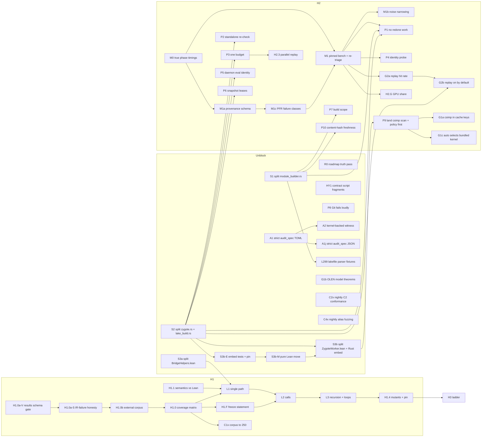

# Sequencing and work graph (`roadmap/HORIZONS.md`)

> **Scope**: the order in which the goals in [`GOALS.md`](./GOALS.md) are worked, as a dependency graph of leaf items that agents can take in parallel. It adds no theorem contract and changes none in [`VALIDATION_CONTRACTS.md`](./VALIDATION_CONTRACTS.md). Facts are from `main` at `94dbd70` (2026-11-15), reconciled to `main` at `fddf22c` (2026-11-16) by R0, then to `main` at `33810f5` (2026-11-16) by R0d (graph–table reconciliation, S3a/HY1 marked done, unresolved parent splits encoded), and from sources linked inline; they are point-in-time.

Source: Thomas's roadmap note of 2026-11-14 (prove Lean → IR first; build faster, hypothesis: pure-Lean kernel compiled by `LeanNative`, GPU if it pays; accelerator plugins last), then a feasibility review of the code and of published results on 2026-11-15. The review changed two of the three ideas; what changed is said where it applies.

| Horizon | Outcome | Status of the original idea |
| :--- | :--- | :--- |
| **H1** | One proven path from `LCNF` to `LNIR` for first-order code with calls and recursion, with a measured coverage number. | Kept, with a smaller exit. Compiling the pure-Lean kernel moves to H3. |
| **H2** | Faster agent loop and builds, measured end to end. | Kept. The native kernel and the GPU are no longer the levers. |
| **H3** | Runtime objects, closures, a native kernel as benchmark, accelerator plugins, remaining backends. | Kept, later. |

---

## What the review found

### The compiler (read from the code)

- **What is proved.** `lowerRealLCNFDecl_sound` (`Proofs/RealLCNFBridgeProofs.lean`): if lowering succeeds and the source evaluation succeeds, the `LNIR` evaluation gives the same result at the same fuel. It is about the function the driver calls, not a model of it.
- **What that covers.** One declaration at a time, no user calls, no recursion, scalars, flat tuples and small non-recursive inductives. A call to another user function is lowered, but the source semantics returns `unsupportedCall`, so the theorem says nothing about any declaration that makes one.
- **What surrounds it unproved.** About 1,100 LOC of `BridgeHelpers.lean` run before and after the proved function (context building, type lowering, an `LCNF` rewrite, post-passes). A second lowering (`lowerPureCode`, a `partial def`) is taken when a declaration has no impure form and has no proof at all. About 250 LOC of helpers are dead.
- **The source semantics is not independent.** `RealLCNFSemantics` imports the lowerer's file and shares its layout and type-lowering definitions.
- **The IR lacks the concepts, not only the lowering.** `evalCode` has no function environment; `Val` has no closure, big `Nat`, string or array of objects; `LNIRCode` has no join point or general loop. The LLVM driver refuses any reference-counted inductive.
- **Consequence.** `con-leche` uses recursive inductives, big `Nat`, arrays, hash maps, strings and `IO`. None of its declarations would lower today (its sources are pinned, not vendored, so this is inferred from its README).

### Build time (from published numbers)

- **The kernel is a small share.** The one full-Mathlib profile found gives typeclass inference 36.5%, `simp` 15.4%, kernel checking 4.7% ([Zulip, undated](https://leanprover-community.github.io/archive/stream/287929-mathlib4/topic/Ways.20to.20speed.20up.20Mathlib.html)). No authoritative 2026 breakdown was found.
- **Fast kernels already exist and ship.** Lean v4.35 bundles `con-leche`, `lean4lean` and `nanoda` behind `lake check --paranoid`. On Mathlib, `con-leche` reports 0.69× the official kernel's instructions and 100 s wall on 8 workers ([PERF.md](https://github.com/leanprover/con-leche/blob/master/PERF.md)).
- **Upstream already parallelizes.** Proof bodies, kernel checks and compilation run in parallel within a file; the module system stops private changes at the file boundary; Lake has a content-addressed remote cache ([FRO talk, 2026-04-24](https://lean-lang.org/presentations/20260424_INRIA/)). Still open upstream: incremental elaboration state on disk, starting downstream builds early.
- **GPU.** No result was found for GPU type checking or proof checking. The credible GPU results nearby are in optimization search (e-graph extraction), not checking.

### Verified compilers (from the literature)

- No mechanized semantics of `LCNF` exists upstream, and the code generator still changes every release. The source semantics is ours to define and to test.
- No verified compiler from a functional language with closures and reference counting to LLVM was found. Mechanized soundness of Lean-style reference counting (`reset`/`reuse`) appears to be open; the published proofs are on paper.
- Single-pass semantic-preservation proofs written by agents are demonstrated at the scale of one pass (CertiCoq ANF, about 7,800 lines, [arXiv 2602.20082](https://arxiv.org/abs/2602.20082)).

---

## H1 — One proven path, first-order code

```
LCNF.Decl ──lowerRealLCNFDecl──► Except Unsupported LNIRDecl      (one function)
                    │
                    └─ Unsupported ─► stock Lean backend for that declaration
```

Rules: one lowering function; what the proof does not cover returns `Unsupported` and is compiled by the stock backend; a helper the proved path does not need is deleted in the same PR; backends other than LLVM are an *unverified tier* and get no features until H3.

| Rung | Outcome | Why it is a rung |
| :--- | :--- | :--- |
| **L1 Single path** | The pure lowering and dead helpers are gone. The theorem is stated for the context the driver builds, with no unproved post-pass (each one is proved, validated by a proved checker, or removed). | Today's theorem holds under hypotheses nobody checks. |
| **L2 Calls** | Both semantics take a function environment. Non-recursive calls between declarations are proved. | Without it the theorem is empty for almost all real code. |
| **L3 Recursion and loops** | Fuel-indexed calls; `LNIR` gets a join-point / loop construct that replaces inlining a join point at every jump. Self and mutual recursion proved. | Needs the theorem statement redesigned, not one more case. |

**Exit of H1**: L1–L3 merged, the statement hash-pinned, and a generated coverage number (share of `Batteries` declarations that lower through the proved path, and the rejection that stops each of the rest).

Reliability measures that go with it:

- **A written trusted base** (`docs/TRUSTED_BASE.md`): Lean's kernel, the `LCNF` semantics, the `LNIR` semantics, the LLVM printer, LLVM, the Lean runtime.
- **The source semantics is tested against Lean itself** (differential interpreter test) and its definitions are separated from the lowerer's.
- **The theorem's shape is stated honestly**: forward simulation on successful runs. A second statement (a source error is never turned into a result) is a later leaf.
- **Mutants** of the lowerer and of the statement must be killed by the proof or by the differential test.

---

## H2 — Faster, measured

Turbo-lean's users are agents running `check` on one declaration thousands of times. That loop, not a cold Mathlib build, is the number to move.

| Order | Work | Basis |
| :-- | :--- | :--- |
| 1 | **Make timing true** (`#408`: phases cover ≥ 90% of wall) and pin a benchmark. Re-measure the open performance issues; several may be fixed already. | Nothing below can be judged without it. |
| 2 | **Stop redoing work**: host-effect taint, import rebuilds, closure purges, tree copies (`#407`, `#433`, `#434`, `#438`–`#442`). | Diagnosed waste on every call. |
| 3 | **One resource budget that reaches every worker** (`#435`, `#437`, `#443`), then parallel replay under it. | Parallelism is bounded by RAM. |
| 4 | **Skip elaboration on warm hits** with CAS proof replay (`#452`), after measuring its hit rate on real edit sequences. | Elaboration is the dominant phase. |
| 5 | **Use the bundled kernels** for `--kernel both` and `auto`, with `--jobs`. | Replaces "compile our own kernel for speed". |
| 6 | Elaboration reuse upstream has not shipped (on-disk incremental state, early downstream start). | Only after 1 shows where cold time goes. |

**Changed from the note**: a native `con-leche` is not a speed lever (kernel ≈ 5% of build time, and faster kernels already ship). It stays in H3 as a compiler benchmark. **GPU** is reduced to one measurement (H2.G): the share of loop time in batched hashing or closed decidable evaluation. Under 10% and it closes.

Every H2 leaf carries a before/after on the pinned benchmark; a change that does not move it is reverted.

---

## H3 — Later

In dependency order: recursive inductives with real reference counting, enabled in LLVM (a mechanized soundness proof of `reset`/`reuse` on a core calculus would be a result of its own); runtime objects (`Nat`, `Array`, `String`, external `Init` calls), where the trusted base is really decided; closures and partial application; `IO`. Then `con-leche` compiled natively, as the standing benchmark and as a second kernel that re-checks the compiler's proofs.

Accelerator plugins start once there is a benchmark to rank them: untrusted search proposes a rewrite together with a certificate (a rewrite sequence, as proof-producing e-graphs do), a proved checker disposes, telemetry picks what to write, and a pass that does not move the benchmark is deleted. The remaining backends and upstream bridges (`G3.3`, `G4`) follow, in the order telemetry says they are used.

---

## Work graph

Leaves are sized to one PR and one owner; the table below is the count of record: 47 rows — 44 leaves plus the three unresolved split parents `H1.0`, `M1` and `S3b`, which are umbrellas over their child leaves and are not takeable as single PRs. *RO* means a read-only measurement or feasibility step comes first.



| id | Outcome | Owns | Needs | Accept | Size |
| :-- | :--- | :--- | :--- | :--- | :-- |
| **R0** | Roadmap says what is true (stale items below); `docs/TRUSTED_BASE.md` | `roadmap/*.md` | – | `sync_docs_inventory.py --check` | S |
| **HY1** *(done `#471` `33810f5`)* | Contract script split into per-milestone fragments, so proof PRs stop colliding. Done: the gates now live in `scripts/contract.d/` (11 per-gate fragments); the runner keeps the preamble and final summary line verbatim, and `scripts/test_contract_script_shape.py` pins the shape | `scripts/contract.d/` | – | `verify_roadmap_contract.sh` output unchanged | S |
| **S1** *(done `#463` `fddf22c`)* | `module_builder.rs` (43k LOC) split: dag / freshness / host-effects / publish. Done: the code now lives in `crates/turbo-lean/src/module_builder/{dag,freshness,host_effects,publish}.rs` | that file | – | `cargo test --locked`, no public API diff | L |
| **S2** *(done `#464` `74fd8e9`)* | `zygote.rs` (17k) and `lake_build.rs` (15k) split by concern. Done: the code now lives in `crates/turbo-lean/src/zygote/{audit,budget,closure,daemon,dispatch,worker}.rs` and `crates/turbo-lean/src/lake_build/{build,cache,env,freshness,impact}.rs` | those files | – | same | L |
| **S3a** *(done `#468` `af3ae66`)* | `BridgeHelpers.lean` split by construct / command. Done: the helpers now live in `lean/LeanNative/IR/BridgeHelpers/{TypesAndSigs,RealBridgeCtxAndSlices,DeclIngestAndValidation,ScalarDagAndJoinPoints,StateAndIntrinsics,HeapAndConstructors}.lean`, pinned by `lean/LeanNative/Tests/BridgeHelpersSplitPin.lean` | `lean/LeanNative/IR/BridgeHelpers.lean`, new files under `lean/LeanNative/IR/BridgeHelpers/` | – | contract script; axiom-audit counts unchanged | M |
| **S3b** | `ZygoteWorker.lean` split by construct / command. Unresolved split parent, encoded as `S3b-E` → `S3b-M` (sequential, same paths; embed tests before any move). Draft `#473` (`44ce925b`) contains the pin only — a pin is not completion | `lean/TurboLean/ZygoteWorker.lean`, its new submodule files, `zygote/worker.rs` (embed + compile list; shared with H2.3 — do not run in parallel) | S2 S3b-M | contract script; axiom-audit counts unchanged; test that the zygote binary builds from the embedded sources | M |
| **S3b-E** | Embed-side split contract before any move: the embed manifest, cache-key hash inputs, scratch writes and `lean -c` compile list in `zygote/worker.rs` are tested against the embedded sources on the unsplit file; the `#473` pin (`lean/LeanNative/Tests/ZygoteWorkerSplitPin.lean`) is the starting point, not completion | `crates/turbo-lean/src/zygote/worker.rs`, `lean/LeanNative/Tests/ZygoteWorkerSplitPin.lean` | S2 | embed manifest / cache-key / hash-input / scratch-write / compile-list tests green on the unsplit file; the `#473` pin kept | M |
| **S3b-M** | The pure Lean command move into submodules, with the embeds kept synchronized (same paths as `S3b-E` plus the new Lean submodule files) | `lean/TurboLean/ZygoteWorker.lean`, its new submodule files, plus the `S3b-E` paths | S3b-E | the `S3b` parent's accept: contract script; axiom-audit counts unchanged; the zygote binary builds from the embedded sources | M |
| **M0** *(done `#461` `8a1d67d`)* | `#408`: phase timings cover ≥ 90% of wall | `phase_timing.rs` (new) | – | test asserts the sum | M |
| **M1** *RO* | Pinned benchmark (`Batteries`, `PFR`), baseline JSON; re-triage `#407`–`#443`; close `#371`. Decision recorded here and on P1: M1 is accepted on the `Batteries` workload alone, and the `PFR` workload is turned on by P1. Unresolved split parent: provenance schema hardening (`M1a`) then PFR failure-class hardening (`M1c`), sequential child leaves on the same paths; `M1b` (statistical noise narrowing) stays after complete `M1` — do not conflate. `M1` resolves only when both `M1a` and `M1c` are reviewed and green | `scripts/bench_check_loop.py` | M0 M1c | script exits 0, JSON committed | M |
| **M1a** | Provenance schema hardening on the existing draft `#465` (`2edc9db`): the baseline must state `turbo_lean_dirty` as an explicit boolean `false` — missing, null or a string fails — and a malformed baseline is never compared against | `scripts/bench_check_loop.py`, `scripts/test_bench_check_loop.py` | M0 | the 60 tests stay green plus malformed-marker regressions: `--validate-only` fails on a missing, null or non-boolean `turbo_lean_dirty` | S |
| **M1c** | PFR failure-class hardening, same paths, strictly after `M1a`: a stale lock must not be reported as a stale-import block; expected-vs-actual import errors are narrowed; the full stub check reports an unrelated failure as exit 4 | `scripts/bench_check_loop.py`, `scripts/test_bench_check_loop.py` | M1a | a regression per class: stale lock ≠ stale-import block, narrowed expected/actual import errors, unrelated full-stub failure exits 4 | M |
| **M1b** | Statistical noise narrowing on the pinned benchmark; stays after complete `M1` (both `M1a` and `M1c` reviewed and green), not part of `M1a`/`M1c` | `scripts/bench_check_loop.py` | M1 | narrowed bands recorded here with their evidence | S |
| **P1** | No redone work on a warm hit (`#407` `#433` `#434` `#438`). Decision recorded here and on M1: M1 is accepted on the `Batteries` workload alone, and the `PFR` workload is turned on by P1 | `module_builder/host_effects.rs` | S1 S2 M1 | bench: zero `lake --no-cache` on warm hit | L |
| **P2** | Standalone re-check: no tree copy, budgeted timeout, `.ir` included (`#440`–`#442`) | `lake_build/freshness.rs` | S2 | three regression tests | M |
| **P3** | One budget object reaches all workers (`#435` `#437` `#443`) | `zygote/budget.rs` | S2 | rlimit test; `eval --timeout-ms 0` passes | M |
| **P4** *RO* | Declaration identity probe in O(declaration) (`#409`) | `splitter.rs` | M1 | bench < 200 ms | M |
| **P5** | Daemon `/eval` identity fix (`#432`) | `server.rs`, `zygote/daemon.rs` | S2 | HTTP test returns 200 | S |
| **P6** | Snapshot leases (`#439`) | `zygote/closure.rs` | S2 | two-run test | S |
| **P7** | `build <Lib>` scope (`#436`) | `module_builder/dag.rs` (shared with L299 — do not run in parallel) | S1 | fixture | M |
| **P8** *(done `#459` `ae16815`)* | Git < 2.46 fails loudly (`#415`) | `trusted_tools.rs` | – | unit test | S |
| **P9** | Land `#455`; import policy for `csimp` / `unsafe` decided before expensive work (`#411` `#412`) | `kernel.rs`, worker audit | full `S3b` (`S3b-E` and `S3b-M`) | 140 Batteries calls pass | M |
| **P10** | Content-hash freshness, `--frozen-cone` (`#339`) | `module_builder/freshness.rs` | S1 | hardlinked-cone fixture, 0 rebuilds | M |
| **G1a** | `csimp` digest in action and cache keys | `db.rs` keys | P9 | key-diff test | S |
| **G1b** *RO* *(done `#460` `ad54090`, model only)* | The M2 theorems hold over real `.olean`, or the docs say they are about a model. The `#460` proof covers the documented OLEN v1 model only; the proof against real `.olean` files is still open, so this leaf is not finished. w-g1b (2026-11-25): the con-leche verification-path tests now run over real `lean`-compiled `.olean` artifacts (pinned v4.35.0) instead of an empty or synthesized search path, and executable guards in `ConLeche.lean` pin that `parseOleanShard` rejects a real `.olean` header (`olean` `0x6F…`, not `OLEN` `0x4F4C454E`); the M2 theorems over real `.olean` bytes remain open | `ConLeche.lean` | – | contract script | L |
| **G1c** | `--kernel auto` selects the bundled `con-leche` when the toolchain matches | `kernel.rs` | P9 | selection test | S |
| **G2a** *RO* | CAS replay hit rate on recorded edit sequences | bench script | M1 | number recorded | S |
| **G2b** | Replay on by default for warm `check`, or deleted | `lake_build/build.rs` | G2a S2 | bench delta | M |
| **H2.3** | Parallel replay under the RAM budget | `zygote/worker.rs` (pool; partly `dispatch.rs`; shared with `S3b-E`/`S3b-M` — do not run in parallel) | P3 | bench scaling | M |
| **H2.G** *RO* | GPU-addressable share of loop time | doc only | M1 | number against the 10% line | S |
| **A1** *(done `#462` `4e2ba1c`)* | `#367`: strict `[audit_spec]` TOML | `audit_spec.rs` parser | – | typo-key test fails closed | S |
| **A2** *RO* | `#367`: kernel-backed witness | `PolicyGates.lean` | A1 | `audit-spec` JSON | L |
| **A1j** | Strict `[audit_spec]` JSON: a misspelled top-level key beside the `audit_spec` / `audit-spec` object fails closed (A1 closed this for TOML only) | `audit_spec.rs` (JSON path) | A1 | test: JSON config with a misspelled top-level key fails closed | S |
| **L299** | `#299`, one fixture per bullet | `module_builder/dag.rs` (lakefile parser; shared with P7 — do not run in parallel) | S1 | Lake-parity fixtures | M |
| **H1.0** *RO* | Generated `LCNF` coverage matrix on `Batteries` and C1. Unresolved split parent, encoded as `H1.0a-V` → `H1.0a-S` (same paths, sequential) plus `H1.0b`; it resolves only through `H1.0b`. Existing draft `#458` (`fd8d618a`) covers the first half and is **blocked**: it must not merge before the defects `H1.0a-V`/`H1.0a-S` harden are fixed | `scripts/lcnf_coverage.py` | H1.0b | CI job emits JSON | M |
| **H1.0a-V** | Results schema gate for the coverage matrix: `scripts/lcnf_coverage.py` and the committed results reject altered, missing or extra subcorpora and invalid count sums | `scripts/lcnf_coverage.py`, `scripts/lcnf_coverage_results.json` | – | self-test plus `--check`, and mutations proving every committed nested field is checked | M |
| **H1.0a-S** | Same paths, after `V`: fail closed on silently dropped module IR failures; investigate the cross-module proof classification and the misleading compiler-aux expansion scope; report honest proof coverage numbers | `scripts/lcnf_coverage.py`, `scripts/lcnf_coverage_results.json` | H1.0a-V | an explicit failure reproduction and honest proof coverage numbers | M |
| **H1.0b** *RO* | External `Batteries` corpus measurement; remains after the corrected inventory (not part of `H1.0a`); stays blocked while the external corpus is unmeasured | `scripts/lcnf_coverage.py` (external corpus) | H1.0a-S | the external corpus counted in the matrix; while it is unmeasured, `H1.0b` and `H1.0` with its downstream stay blocked — a recorded blocker does not close them | M |
| **H1.1** | `RealLCNFSemantics` as interpreter vs stock Lean; shared definitions separated from the lowerer. Stays one leaf; do not split | `Driver/EvalLCNFCLI.lean` (new) | – | `mismatch_count == 0` | M |
| **H1.F** | Statement of the H1 theorem frozen and pinned; unverified backends labelled in `--help`. w-h1f (2026-11-26): landed — the statement of `lowerRealLCNFDecl_sound` is frozen in `lean/LeanNative/SpecLocked.lean` (file sha256 `da41c9c2…`; kernel `Expr.hash` pin `306234630`, enforced by an in-file `#eval` gate on every `lake build` of the `LeanNative` lib), and the nine non-LLVM backend commands plus a tier legend carry `[unverified tier]` in both drivers' `--help`, pinned by `#guard`s in `CoreCLI.lean`; not marked done while `H1.0` (its Needs) is open | `SpecLocked.lean`, `CoreCLI.lean` | H1.0 | hash pin | S |
| **L1** | Single path (rung L1) | `Bridge.lean`, helper split | S3a H1.0 H1.1 | one lowering callee; `ΔLOC < 0` | L |
| **L2** | Calls (rung L2) | `Semantics/Eval.lean`, `Proofs/LowerCalls.lean` | L1 H1.F | leaf `0 sorryAx`; matrix moves | L |
| **L3** | Recursion and loops (rung L3) | `IR/AST.lean`, `Proofs/LowerRec.lean` | L2 | same | L |
| **H1.4** | Mutant kill matrix; coverage number published | `Proofs/LowerRefines.lean` | L3 | mutants in CI | M |
| **C2x** | `Batteries` as nightly C2 conformance | workflow, packages dir | – | `--tier C2` green | M |
| **C4x** | 10k-seed nightly alias fuzzing | `fuzz_lcnf_conformance.py` | – | nightly green | M |
| **C1x** | C1 corpus to 250 programs, chosen by the matrix | corpus manifest | H1.0 | `--tier C1` | L |

**Start width**: R0, H1.0a-V, M1a, S3b-E, A2, A1j, P2, P3, P5, P6, P7, P10, L299, H1.1, C2x, C4x have no unmet dependency and disjoint files (P7 and L299 share `module_builder/dag.rs` — do not run in parallel): sixteen leaves, about eight at once per machine because six need Lean builds.

**Critical path**: H1.0a-V → H1.0a-S → H1.0b → H1.0 → L1 → L2 → L3 → H1.4, with H1.1 in parallel into L1. Three large proof items in series; nothing shortens it except starting H1.0a-V and H1.1 now.

**The three splits pay first.** Seven open issues need the module builder, nine need `zygote.rs` or `lake_build.rs`, and every H1 rung needs `BridgeHelpers.lean`. S1, S2 and S3a have landed, so those items are unblocked (`module_builder/{dag,freshness,host_effects,publish}.rs`; `zygote/{audit,budget,closure,daemon,dispatch,worker}.rs`; `lake_build/{build,cache,env,freshness,impact}.rs`; `BridgeHelpers/{TypesAndSigs,RealBridgeCtxAndSlices,DeclIngestAndValidation,ScalarDagAndJoinPoints,StateAndIntrinsics,HeapAndConstructors}.lean`).

---

## Cleanup this implies (R0)

**One owner per kind of fact.** Remaining work: one GitHub issue per leaf, and the "Remaining Open Roadmap Items" section of `GOALS.md` is deleted. Order of work: this file. Theorem signatures: the contract script, with docs linking to it. Coverage status: JSON generated by the conformance runner. Pre-PR commands: `AGENTS.md` (fold `MAXWELL_STRATEGIES.md` into it).

**Stale statements to fix.** *(R0b: the file rows below are fixed on `main` — `GOALS.md` G2 Stage B, G1, "Priority 0", G5; `OPEN_CHALLENGES` B2 gate; `roadmap/README.md` principle 3. `OPEN_CHALLENGES` B1 already stated this on `main`. The `#407`/`#409`/`#411` row is a re-measure note that stays with M1.)*

| Where | Says | Is |
| :--- | :--- | :--- |
| `GOALS.md` G2 Stage B | queued | landed in `#451`, `#452` |
| `GOALS.md` G1, `OPEN_CHALLENGES` B1 | wiring `con-leche` into `--kernel` remains | wired as an external binary (`#448`, `#449`); `auto` is routed by PolicyGates to con-leche when `conLecheSupported` is true, but the current Rust resolver does not probe support for `auto`, so production `auto` currently resolves to standard; cache-key binding remains open |
| `OPEN_CHALLENGES` B1, B2 gates | the M2 / M3 theorems are discharged | they hold over the in-repo `"OLEN"` model, not real `.olean` (the root `README` says so) |
| `GOALS.md` "Priority 0" | remaining | describes landed behaviour |
| `GOALS.md` G5 | `CAbiEmit.lean` removed | file exists, 1,275 LOC |
| `roadmap/README.md` principle 3 | 7,500+ lines of string interpolation in `CoreCLI.lean` | 995 LOC |
| Issues `#407`, `#409`, `#411` | open, data of 2026-11-10 | verified-import stamps landed since; re-measure in M1 |

**Park, with a note saying why.** `BENDRT_EXPLORATION.md` (529 lines; BRT2–BRT5 contradict the backend freeze; keep BRT0 as input to L3). Track A accelerators until H3. Further theorems on the `"OLEN"` model: either G1b makes them real or they stop. `G4`'s "≥ 50% LOC compression" and `G1`'s "< 0.65× instructions": targets with no consumer and no gate.
