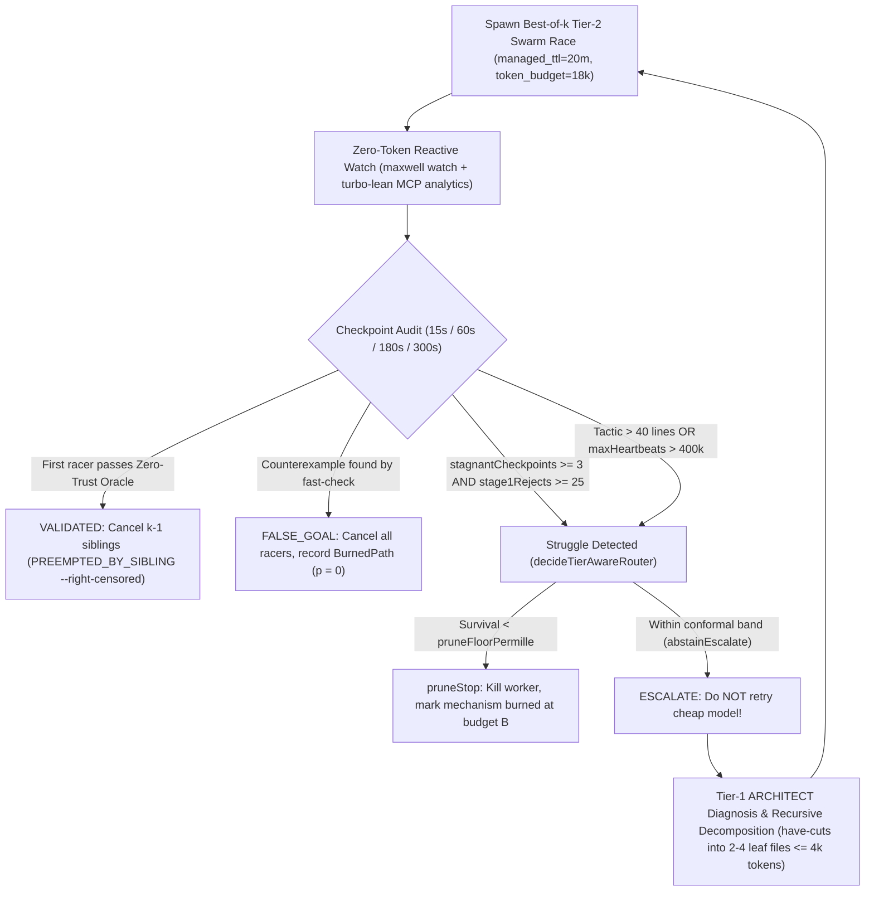

# Autonomous Execution Strategies via `maxwell`, Orb & `telemetry.thomas.md` (`S1`–`S6`)

> **Scope**: This document defines **how** we execute [`GOALS.md`](./GOALS.md) under the strict validation gates of [`VALIDATION_CONTRACTS.md`](./VALIDATION_CONTRACTS.md) and [`CONFORMANCE_SUITE.md`](./CONFORMANCE_SUITE.md). It integrates the **`lfglabs-dev/maxwell`** Bayesian governor (`maxwell-core` + `scripts/maxwell`), the **Orb (`sandboxed` MCP)** multi-provider fleet, **`https://telemetry.thomas.md`** (`Th0rgal/telemetry-hub`), and the **Hindsight (`memory.thomas.md`)** methodologies.

---

## Strategy S1: Two-Tier Model & Provider Allocation Matrix

We discovered and audited the exact models available across our Orb connectors (`hermes`/`paloma`, `cursor_cloud`, `opencode`, `antigravity`, and local `dgx-spark`). To maximize velocity per dollar and prevent cheap models from corrupting architecture or specifications, every task in the roadmap DAG is routed strictly by **Stage** and **Solver Tier**:

### Tier 0: Local Zero-Cost Sub-Millisecond Filters (Always Run First)
Before spending a single LLM token on any branch:
1. **`turbo-lean fast-check <file.lean> --decl <thm> --json`** (`< 1 ms` CPU SIMD / DGX Spark GPU counterexample search across `UInt8..64`, `BitVec`, `Word256`, `Nat`). If a counterexample is found $\implies$ `outcome: "FALSE_GOAL"`, $p = 0$.
2. **Corpus Hit-Count Census (`Flow 06`)**: For any compiler pass or rewrite rule (`Goal G4`), scan the dumped `.lnir` corpus first. If `corpus_hits == 0` $\implies$ `outcome: "FALSE_GOAL"`, $p = 0$.
3. **`ANVIL2 + TRM + NVFP4` Micro-Model (`13.5 KB` on DGX Spark)**: Predicts survival probability (`99.84%` cutoff accuracy) and top-2 tactic skeletons (`94.20%` top-2 accuracy) in microseconds.

### Tier 1: `ARCHITECT` Models ($k = 1$, Reserved for Crucial High-Leverage Steps)
**Never** use Tier-1 models for repetitive tactic grinding or parameter sweeps. Reserve them exclusively for:
- **`VALIDATE_GOAL` & `META_BOTTLENECK`** (building/freezing harnesses and `audit-spec` v2 probes),
- **`SPEC` & `DECOMPOSE`** (authoring locked `SpecLocked.lean` headers, designing the 3 unified compiler engines in `Goal G4`, and splitting `effort_p50 > 6000` goals into leaf files),
- **`ESCALATED_DIAGNOSIS`** (when Tier-2 racers hit `abstainEscalate`), and
- **`CERTIFY_REVIEW`** (running the 10-second Reviewer Protocol from `VALIDATION_CONTRACTS.md`).

| Canonical Model ID | Orb Connector / Backend | Empirical Strengths (from `telemetry.thomas.md`) | Assigned Roadmap Role |
| :--- | :--- | :--- | :--- |
| **`openai/gpt-6.1-sol`** | `codex` / `hermes:paloma` / `cursor_cloud` | Highest empirical Bayesian commit score (`1.601`, `p_mean = 0.952`, median `5.1k–5.6k` tokens). Best at systems kernel specs & master composition. | **Lead Spec & Composition Architect**: Authoring `SpecLocked.lean`, `con-leche` `.olean` mmap bridge (`G1`), and master composition theorems. |
| **`anthropic/claude-fable-5-1`** | `claudecode` / `hermes:paloma` / `cursor_cloud` (`1M` ctx, adaptive thinking) | Adaptive structural synthesis (`1.25x` speed, `$0.008/1k`). Excels at compiler IR refactoring and algebraic abstraction design. | **Lead Simplicity & Refactoring Architect (`G4`)**: Compressing `CoreCLI.lean` & `Bridge.lean` into `EqSat`, `LoopSchedule`, and `OwnershipRC`. |
| **`anthropic/claude-opus-5-5`** | `claudecode` / `hermes:paloma` / `cursor_cloud` (`1M` ctx, `effort=high`) | Deepest multi-pass compiler induction (`74/74` tight specs on `PanToWordNoStubCall`). *Note: Always pass prompts through `maxwell frame-prompt`.* | **Deep Induction & Semantics Architect (`G1`, `G3`)**: `LCNF → LNIR` simulation proofs, `lean-mlir` poison semantics, and `LNSym` ARM64 proofs. |
| **`openai/gpt-6-astra`** | `opencode` / `hermes:paloma` | Algebraic & algorithmic decomposition (`1.20x` speed, `$0.010/1k`). | **Polyhedral & Crypto Architect (`G3.3`, `G4`)**: `GF(2^128)` carryless multiplication, Radix-4 NTT fusion, and affine loop scheduling proofs. |
| **`google/gemini-4-argon`** | `antigravity` / `hermes:paloma` / `cursor_cloud` | Whole-repo context synthesis (`p_mean = 0.920`, score `1.575`, `$0.006/1k`). | **Cross-Repo Audit & Quorum Voter**: Auditing `CoreCLI.lean` (7.5k LOC) / `Bridge.lean` (2k LOC) for dead code and running 3-model spec quorums. |

### Tier 2: `SWARM_FAST` Models (Best-of-$k$ Parallel Leaf Racing, $k \in \{2, 3, 4\}$)
Once `SpecLocked.lean` is frozen by Tier 1 and decomposed into leaf tasks (`1 lemma = 1 file = 1 worker`, `effort_p50 <= 6000` tokens), dispatch heterogeneous Best-of-$k$ races (`maxwell race-plan`) across distinct provider families:

| Canonical Model ID | Provider / Host | Speed / Cost | Assigned Leaf Race Role (`GRIND` / `OPTIMIZE` / `PROBE`) |
| :--- | :--- | :--- | :--- |
| **`spark/leanstral-1.5-119b-a6b`** | `dgx-spark` / `hermes:paloma` (`mistral/labs-leanstral-1-5-1`) | **`3.8x`** / `$0.0002/1k` | **Primary Lean 4 Tactic Racer**: `simp`, `omega`, `bv_decide`, and structural induction leaf proofs (`M2`–`M5`). |
| **`xai/grok-4.7`** | `hermes:paloma` / `cursor_cloud` / `opencode` | **`3.4x`** / `$0.0015/1k` | **Arithmetic & Rewrite Racer**: Fast bitvector/UInt64 bridges, inequalities, and peephole rule synthesis. |
| **`kimi/k3.1-pro-highspeed`** & **`kimi/k2.8-code`** | `hermes:paloma` / `opencode` | **`3.2–3.6x`** / `$0.0010/1k` | **SIMD & Bit-Parallel Racer**: `omega` bounds, loop unrolling, and C-ABI / SIMD kernel lowering (`G3.3`, `G4`). |
| **`minimax/MiniMax-M3.1-Flash`** | `hermes:paloma` / `opencode` | **`4.0x`** / `$0.0008/1k` | **Mutant & Fuzzing Racer (`V3`, `G5`)**: Generating `MutantSuite.lean` (`negWitness`es) and shrinking 3-way conformance counterexamples. |
| **`zai/glm-5.3-flash`** | `hermes:paloma` / `dgx-spark` | **`3.6x`** / `$0.0008/1k` | **Symbolic Enumeration Racer**: Fast witness construction (`posWitness`) and `SymbolicTV` case splits. |
| **`openai/gpt-5.6-terra`** | `hermes:paloma` / `cursor_cloud` | **`3.0x`** / `$0.0020/1k` | **Compiler Leaf Patch Racer**: Implementing isolated `VerifiedTransformContract` passes against frozen specs. |

> **Hard Deprecation Rule (from `telemetry.thomas.md` empirical priors)**: Never route deep specification or master composition tasks to `gpt-5.6-sol` when `openai/gpt-6.1-sol` or `openai/gpt-6-astra` is available; keep `gpt-5.6-terra` strictly in Tier-2 leaf races.

---

## Strategy S2: Detecting When a Cheap Model Struggles & Automatic Escalation

Cheap models fail in predictable ways: they loop on failing `simp`/`omega` calls, balloon proof terms (`proofTermNodes > 50,000`), crank up `set_option maxHeartbeats 1000000`, or try to edit outside their leaf file. We combine **`maxwell-core`'s C-ABI survival automaton** with **`turbo-lean`'s live MCP telemetry** to catch struggle in real time without burning Boss tokens:



### Concrete Struggle Signals Monitored Automatically
1. **Stagnant Subgoal Hash Across 3 Checkpoints (`stagnantCheckpoints >= 3` + `stage1Rejects >= 25`)**:
   - Read from `/dev/shm/turbo-lean-staging-*/mcp_agent_analytics.json` and passed to `lean_maxwell_decide_worker_action`.
   - Triggers `.cancelSurvivalHazard` (`CANCEL_SURVIVAL_HAZARD`) immediately instead of letting the cheap model burn its remaining token budget.
2. **Inline Proof Complexity Cap (`Flow 01` Rule)**:
   - Any worker diff introducing a tactic block $> 40$ lines, `proofTermNodes > 50,000` (`governor_accept_blocks_bloated_proof_term`), or `maxHeartbeats > 400000` is automatically halted.
3. **Conformal 3-Action Router (`decideTierAwareRouter` in `Maxwell/Spec.lean`)**:
   - Instead of treating a cheap model's timeout as `FALSE_GOAL` (which would permanently poison a true theorem!), `Maxwell/Spec.lean` records a **right-censored `BurnedPathEntry`** at `(sliceId, testedTokenBudget)` (`right_censored_burned_path_allows_expanded_budget`).
   - When `decideTierAwareRouter` returns `.abstainEscalate` (`2`), the orchestrator **automatically escalates** by invoking a single Tier-1 `ARCHITECT` task (`claude-fable-5-1` or `claude-opus-5-5`) with the worker's failed goal state to either:
     - Split the theorem along `have` cuts into 2–4 simpler micro-lemmas (`effort_p50 <= 4000` tokens), or
     - Add a missing `@[simp]` bridge lemma / `TypeclassBridge.lean` instance before re-launching the Tier-2 swarm.

---

## Strategy S3: Multi-Model Quorums for High-Stakes Spec & Architecture Decisions

While Best-of-$k$ racing is optimal for **Certification (`GRIND`)** (where the first proof checked by the kernel wins), **Specification (`SPEC`)** and **Architecture (`CONJECTURE`)** require a **3-Model Quorum** so subtle spec bugs or over-complicated abstractions are caught before any proof workers launch:

1. **When to Run a 3-Model Quorum**:
   - Locking a new `SpecLocked.lean` file (`Goal G1`–`G4`),
   - Designing the core data structures for `EqSat`, `LoopSchedule`, or `OwnershipRC` (`Goal G4`),
   - Reviewing a suspected `ReferenceDiscrepancy` in `LCNF → LNIR` (`Bridge.lean`).
2. **How to Execute the Quorum in `< 30s` (via `$OPENAI_BASE_URL` Proxy)**:
   - Per `orb-basics`, launch 3 parallel single-turn completion requests via `$OPENAI_BASE_URL/chat/completions` to three orthogonal frontier families:
     1. `anthropic/claude-opus-5-5`
     2. `openai/gpt-6.1-sol`
     3. `google/gemini-4-argon`
   - Prompt each model independently to **attack the proposed `SpecLocked.lean`** by proposing:
     - A vacuous/degenerate input that satisfies the precondition trivially,
     - A realistic buggy compiler pass that would slip through the postcondition (`negWitness`), and
     - A simpler formulation with fewer AST nodes ($J_{\text{spec}} = \text{mutation\_kill\_rate}^2 / \text{AST\_size}$).
   - Synthesize all discovered `negWitness`es into `MutantSuite.lean` before running `maxwell freeze-tool SpecLocked.lean`.

---

## Strategy S4: Closed-Loop Telemetry (`telemetry.thomas.md`) & Hindsight (`memory.thomas.md`)

### 1. Namespaced Quantitative Telemetry (`https://telemetry.thomas.md`)
Every autonomous wave executing this roadmap feeds `Th0rgal/telemetry-hub` (`https://telemetry.thomas.md/v2/ns/th0rgal/*`):
- **Pre-Wave Identity & Currency Pinning (`Rule 0`)**:
  ```bash
  maxwell telemetry doctor --write-env .maxwell/telemetry.env
  source .maxwell/telemetry.env
  ```
  Propagates `SANDBOXED_TELEMETRY_SESSION_ID` (`SANDBOXED_SH_MISSION_ID`), `SANDBOXED_TELEMETRY_NAMESPACE=th0rgal`, and `SANDBOXED_TELEMETRY_BATCH_ONLY=1` into all 6–8 pre-warmed worktrees (`maxwell warm-pool`).
- **Coarse `--goal-class` Buckets (Never Fragment Priors)**:
  Every `maxwell record --boss-verified --from-transcript <worker_transcript>` call uses the canonical `(domain, goal_class)` pairs so Empirical-Bayes shrinkage (`(domain, goal_class, model) -> (domain, goal_class, *) -> (domain, *, *)`) has high statistical power:
  - **Milestone M1/M3 (`formal_spec`)**: `spec_mutation_audit`, `spec_roundtrip_codec`, `spec_equivalence`
  - **Milestone M2 (`lean_proof` — `con-leche`)**: `inductive_structural`, `typeclass_bridge`, `ffi_memory_model`
  - **Milestone M4 (`compiler_optimization` — 3 Engines)**: `pass_unbox_scalar`, `pass_loop_fusion_licm`, `pass_rc_borrow_elision`
  - **Milestone M5 (`lean_proof` / `performance_optimization` — Backends)**: `bitwise_u64_limb`, `kernel_ntt_fft`, `kernel_field_limb_simd`
- **Right-Censored Sibling Accounting (`preempted_sibling_preserves_failure_beta`)**:
  When Racer 1 in a Best-of-3 race passes `turbo-lean check`, immediately cancel Racers 2 and 3 and record them with:
  ```bash
  maxwell record --boss-verified --from-transcript <racer_id> \
    --outcome PREEMPTED_BY_SIBLING --right-censored ...
  ```
  This preserves exact solve-rate posteriors (`alpha, beta, sample_count`) per model in `telemetry.thomas.md`.
- **End-of-Wave Self-Heal & Priors Refresh**:
  Run `maxwell audit-campaign --fix && maxwell telemetry flush` after every wave, and retrain the `13.5 KB` `ANVIL2 + TRM + NVFP4` weights (`training/anvil2_trm_trainer.py`) after each milestone.

### 2. Qualitative Personal Memory (`https://memory.thomas.md` / `spark-memory`)
While `telemetry.thomas.md` stores structured events and Beta-Binomial priors, **`spark-memory` (Hindsight on `dgx-spark:8890`)** stores high-signal architectural lessons and domain invariants:
- At the start of each Milestone (`M1`–`M6`), query `spark-memory` (`recall` / `reflect`) for prior `turbo-lean`, `lean-native`, `Verity`, and `evm.fast-dev` insights.
- Whenever a non-obvious semantic bug is caught by the 3-way conformance suite (e.g., an `LCNF` papering edge case or a `lean-mlir` poison propagation subtlety), retain a concise 10-line note in `spark-memory` (`kp-turbo-lean-roadmap`).

---

## Strategy S5: Orb Resource Escrow & Warm Worktree Execution Loop

To execute waves with zero cold-build wait time and 3× lower VM reservation cost:
1. **Boss Mission Unlimited (`mode: "none"`), Child Missions Bounded (`mode: "own"`)**:
   - The Boss orchestrator runs with `mode: "none"`.
   - Every child worker spawned via Orb `start_mission` receives an explicit envelope verified by `lean_maxwell_verify_orb_budget_envelope`:
     - Tier-2 `SWARM_FAST` leaf proof/pass worker: `managed_ttl_minutes: 20`, `budget_usd: 0.05`, `token_budget: 18000`, `remote_node_id: "auto-managed:default"`.
     - Tier-1 `ARCHITECT` / benchmark worker: `managed_ttl_minutes: 30`, `budget_usd: 0.15`, `token_budget: 45000`, `remote_node_id: "auto-managed:large"`.
2. **Pre-Warmed Worktree Pool (`< 2s` Setup)**:
   - Provision 8 isolated worktrees with hardlinked `.olean` caches before launching a wave:
     ```bash
     maxwell warm-pool /var/lib/sandboxed-node/work/turbo-lean /var/lib/sandboxed-node/worktrees/wave-1 --count 8
     ```
   - Workers use `turbo-lean agent-step <file.lean> --decl <id>` (`~2 ms` warm `ZygoteWorker`) instead of cold `lake build`.
3. **Strict separation of `META_BOTTLENECK` Waves and `ObjectWave`s (`Rule 1`)**:
   - If any module in `turbo-lean` takes $> 45\text{s}$ to compile (`T_compile_module > 45s`) or conformance testing takes $> 60\text{s}$, open a bounded `META_BOTTLENECK` wave ($\le 15\%$ budget) to split the module or cache `.olean` shards, then lock the tool via `maxwell freeze-tool` before resuming `ObjectWave`s.

---

## Strategy S6: Step-by-Step Wave Execution Plan for Milestones `M1`–`M6`

| Wave | Milestone | Stage Flow | Models & Allocation | Exit Oracle (`verification_command`) |
| :--- | :--- | :--- | :--- | :--- |
| **Wave 1** | **M1: Anti-Cheat & Conformance Harness** | `META_BOTTLENECK` $\to$ `SPEC` | `gpt-6.1-sol` + `claude-fable-5-1` ($k=1$) | `audit-spec` v2 unfolds multi-hop defs; `conformance-check --tiers C1` passes 250 tests; frozen via `maxwell freeze-tool`. |
| **Wave 2** | **M2: `con-leche` Zero-Copy Kernel (`G1`)** | `SPEC` $\to$ `DECOMPOSE` $\to$ `GRIND` | `claude-opus-5-5` (spec/bridge) $\to$ Best-of-3 `leanstral-1.5` + `grok-4.7` + `gpt-5.6-terra` on 6 leaf lemmas | `turbo-lean pr-verify --kernel con-leche` passes in `< 1 ms` with `0 sorryAx` on `TurboLean/Spec.lean`. |
| **Wave 3** | **M3: Elaboration De-Trusting (`G2`)** | `SPEC` $\to$ `GRIND` $\to$ `CERTIFY` | `gpt-6.1-sol` (`HeaderPin` + CAS wire blob) $\to$ Best-of-3 Tier-2 racers | `header_pin_prevents_statement_spoofing` & `cas_proof_replay_sound` proved; warm replay $\ge 10\times$ faster. |
| **Wave 4** | **M4: Pure `Bridge.lean` & 3 Unified Engines (`G3.1`, `G4`)** | `CONJECTURE` (Quorum) $\to$ `SPEC` $\to$ `GRIND` | 3-Model Quorum (`opus-5-5`, `gpt-6.1-sol`, `gemini-4-argon`) $\to$ `claude-fable-5-1` (refactor) $\to$ 8-worktree Tier-2 swarm | `Bridge.lean` $< 350\text{ LOC}$; `applyRewriteTable_sound`, `scheduleStructuredLoop_sound`, `elideAndMutateRC_sound` proved (`0 sorryAx`); $-\mathbf{2,500}\text{ LOC}$. |
| **Wave 5** | **M5: Official Backend Semantics (`lean-mlir` / `LNSym`) (`G3.3`, `G4`)** | `SPEC` $\to$ `GRIND` $\to$ `OPTIMIZE` | `claude-opus-5-5` + `gpt-6-astra` (specs) $\to$ `kimi/k3.1-pro-highspeed` + `leanstral-1.5` + `grok-4.7` | `CoreCLI.lean` $< 1,000\text{ LOC}$; `lowerToLeanMLIR_sound` & `arm64_f128_kernel_refines_lnir` proved; $-\mathbf{4,500}\text{ LOC}$. |
| **Wave 6** | **M6: 10k Fuzz & Cross-Regime Holdout (`G5`)** | `CERTIFY` (`DEV` $\to$ `SEALED` $H^*$) | `minimax/MiniMax-M3.1-Flash` + `zai/glm-5.3-flash` (fuzz/mutants) $\to$ `gpt-6.1-sol` (final audit) | `10,000` fuzz seeds + `C1..C4` pass with `0` discrepancies, `0` RC leaks, and $H^*$ holdout invariant satisfied. |
